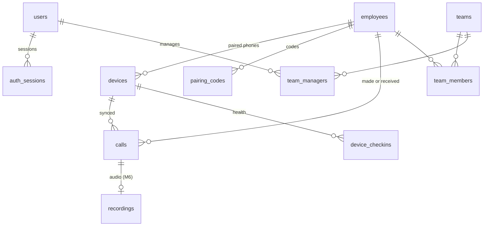

# Data model and API

Every table and route on one page: what each milestone adds, and the conventions they all follow. Each milestone's spec has the full detail for its own tables and routes. When a spec changes a table or route, update this file in the same commit; if the two disagree, the spec wins until this file is fixed.

Last reviewed: 7 November 2026 (design only; nothing is built).

## Conventions

| Topic | Rule |
| --- | --- |
| IDs | `uuid` with `gen_random_uuid()`. High-volume append tables (`calls`, `device_checkins`, `audit_logs`, `webhook_deliveries`) use `bigint generated always as identity`. |
| Phone numbers | Digits with country code, no plus: `919812345678`. A 10-digit Indian mobile gets `91` added; anything else (landline, toll-free, short code, private number) is stored as the phone gave it, digits only, and flagged `number_kind`. |
| Times | `timestamptz` in UTC. Days, hours and "yesterday" are India time (`Asia/Kolkata`). |
| Durations | Whole seconds in `int`. |
| One company | No `client_id`. Access is by role: `admin` sees everything; `manager` sees employees in their teams (M2). Every employee-data query goes through one scope function that applies this. |
| Migrations | New numbered file only; never edit a merged one; only add tables, nullable columns and indexes. Claim the number in the tracker's registry first. |
| Routes | `/api/...` for the panel (session cookie); `/device/v1/...` for the app (device token); `/v1/...` for the CRM (API key, M5); public: `/healthz`, `/api/auth/login`, `/i/:code` (install page), `/app/latest.apk`. A route-walking test fails CI for any other pattern. |
| Errors | `{ "error": "<CODE>", "message": "<text>" }`, with `details` for field errors on 400. |
| Schemas | Request and response bodies are Zod schemas in `packages/shared`. The app's Kotlin models are checked against the same JSON examples in tests. |
| Lists | `limit` (default 50, maximum 500) and `cursor`, returning `{ items, nextCursor }`. |
| Filters | One call filter shape shared by history, every report and the export (below). |

### The call filter

Used by `/api/calls`, `/api/reports/*`, the CSV export and `/v1/*`.

| Field | Type | Notes |
| --- | --- | --- |
| `from`, `to` | ISO time | Required. Call start time. At most 180 days apart. |
| `syncedFrom`, `syncedTo` | ISO time | Optional; for the CRM to fetch "what arrived since". |
| `employeeIds` | uuid[] | Optional |
| `teamIds` | uuid[] | Optional (M2) |
| `types` | `incoming`, `outgoing`, `missed`, `rejected` | Optional |
| `minTalk`, `maxTalk` | seconds | Optional, inclusive |
| `minRing`, `maxRing` | seconds | Optional, inclusive |
| `numbers` | string[] | Outside numbers, normalised before matching |
| `includeExcluded` | boolean | Default false (M2) |
| `hasRecording` | `yes`, `no`, `missing`, `pending` | M6 |

## How the tables connect

## Tables

### Access (M1, M2)

| Table | Columns | Milestone |
| --- | --- | --- |
| `users` | `id`, `email unique`, `name`, `role` (`admin`, `manager`), `password_hash` (argon2id), `disabled_at`, `failed_login_count`, `login_locked_at`, `created_at` | M1 (`manager` used from M2) |
| `auth_sessions` | `id`, `user_id`, `token_hash unique`, `created_at`, `last_seen_at`, `expires_at`, `revoked_at`, `user_agent`, `ip_address` | M1 |
| `audit_logs` | `id bigint`, `user_id null`, `device_id null`, `action`, `target_type`, `target_id`, `details jsonb`, `created_at` | M1 |

### Employees and phones (M1)

| Table | Columns | Milestone |
| --- | --- | --- |
| `employees` | `id`, `name`, `emp_code null unique`, `company_number` (digits), `crm_employee_id null unique` (M5), `status` (`active`, `left`), `created_at`, `left_at` | M1 |
| `pairing_codes` | `id`, `employee_id`, `code_hash`, `expires_at`, `used_at`, `created_by` | M1 |
| `devices` | `id`, `employee_id`, `token_hash unique`, `brand`, `model`, `android_version`, `sdk_int`, `app_version`, `default_dialer`, `sim_slot`, `sim_carrier`, `phone_account_id`, `consent_at`, `consent_version`, `paired_at`, `revoked_at`, `last_sync_at`, `last_checkin_at` | M1 (`last_checkin_at` from M4) |

An employee has at most one active device; pairing a new phone revokes the old one.

### Calls (M1)

| Table | Columns | Milestone |
| --- | --- | --- |
| `calls` | `id bigint`, `employee_id`, `device_id`, `device_call_id` (the call log's row ID), `number`, `number_kind`, `contact_name null`, `type`, `started_at`, `talk_seconds`, `ring_seconds null`, `ended_at null`, `note null` (M4), `synced_at`, `updated_at`. Unique (`device_id`, `device_call_id`). Indexes: (`employee_id`, `started_at`), (`number`, `started_at`), (`synced_at`) | M1 |

### Reports (M2)

| Table | Columns | Milestone |
| --- | --- | --- |
| `teams` | `id`, `name unique`, `created_at` | M2 |
| `team_members` | `team_id`, `employee_id` | M2 |
| `team_managers` | `team_id`, `user_id` | M2 |
| `excluded_numbers` | `number primary key`, `label`, `created_by`, `created_at` | M2 |
| `daily_employee_stats` | `employee_id`, `day date`, counts and seconds per call type, `connected`, `unique_numbers`, `first_call_at`, `last_call_at`, `active_seconds`, `idle_seconds`, `computed_at`. Primary key (`employee_id`, `day`). Recomputed for any day a synced call touches. | M2 |

### Email (M3)

| Table | Columns | Milestone |
| --- | --- | --- |
| `email_outbox` | `id`, `to_address`, `subject`, `body_html`, `kind`, `status` (`queued`, `sent`, `failed`), `attempts`, `last_error`, `created_at`, `sent_at` | M3 |
| `report_subscriptions` | `user_id`, `kind` (`daily`), `enabled` | M3 |

### Phone health and updates (M4)

| Table | Columns | Milestone |
| --- | --- | --- |
| `device_checkins` | `id bigint`, `device_id`, `at`, `battery_pct`, `battery_optimised bool`, `permissions jsonb`, `sim_present bool`, `pending_calls int`, `default_dialer`, `app_version` | M4 |
| `app_releases` | `id`, `version_code unique`, `version_name`, `sha256`, `file_key`, `min_supported_code`, `notes`, `published_at` | M4 |

### CRM integration (M5)

| Table | Columns | Milestone |
| --- | --- | --- |
| `api_keys` | `id`, `name`, `key_hash unique`, `prefix`, `created_by`, `created_at`, `revoked_at`, `last_used_at` | M5 |
| `webhooks` | `id`, `url`, `secret_encrypted`, `events text[]`, `enabled`, `created_at` | M5 |
| `webhook_deliveries` | `id bigint`, `webhook_id`, `event`, `payload jsonb`, `status`, `attempts`, `next_attempt_at`, `last_status_code`, `created_at` | M5 |

### Recordings (M6)

| Table | Columns | Milestone |
| --- | --- | --- |
| `recordings` | `id`, `call_id unique`, `status` (`pending_upload`, `uploaded`, `missing`, `not_expected`), `object_key`, `size_bytes`, `audio_seconds`, `mime_type`, `match_score`, `matched_at`, `uploaded_at`, `deleted_at` | M6 |
| `recording_plays` | `id bigint`, `recording_id`, `user_id`, `at` (also in `audit_logs`) | M6 |

### Jobs (M2)

| Table | Columns | Milestone |
| --- | --- | --- |
| `jobs` | `id bigint`, `kind`, `payload jsonb`, `run_at`, `locked_at`, `attempts`, `last_error`, `done_at`. Workers take jobs with `for update skip locked`. | M2 |

## API

### Panel (`/api`, session cookie)

| Method | Route | Who | Milestone |
| --- | --- | --- | --- |
| POST | `/api/auth/login`, `/api/auth/logout` | anyone, logged in | M1 |
| GET | `/api/auth/me` | logged in | M1 |
| GET, POST | `/api/employees` | admin (managers read their teams' from M2) | M1 |
| GET, PATCH | `/api/employees/:id` | admin | M1 |
| POST | `/api/employees/:id/pairing-code` | admin | M1 |
| POST | `/api/employees/:id/revoke-device` | admin | M1 |
| GET | `/api/calls` (call filter) | admin; manager from M2 | M1 |
| GET | `/api/calls/export.csv` (call filter) | admin; manager from M2 | M1 |
| GET | `/api/reports/summary`, `/employees`, `/analysis`, `/never-attended`, `/not-picked-up`, `/unique-numbers`, `/hourly`, `/daywise` (call filter) | admin, manager | M2 |
| GET, POST, DELETE | `/api/teams`, `/api/excluded-numbers`, `/api/users` | admin | M2 |
| GET | `/api/devices` (health list) | admin, manager | M4 |
| POST | `/api/app-releases` | admin | M4 |
| GET, POST, DELETE | `/api/integrations/api-keys`, `/api/integrations/webhooks` | admin | M5 |
| GET | `/api/calls/:id/recording` (returns a 5-minute play link) | admin, manager | M6 |

### Phone app (`/device/v1`, `Authorization: Bearer <device token>`)

| Method | Route | Purpose | Milestone |
| --- | --- | --- | --- |
| POST | `/device/v1/pair` | Body: `{ code, brand, model, androidVersion, sdkInt, appVersion, defaultDialer, simSlot, simCarrier, phoneAccountId, consentVersion }`. No token needed. Returns `{ deviceToken, employee: { name, companyNumber }, settings }` | M1 |
| POST | `/device/v1/calls` | Batch of up to 200 calls. Returns `{ accepted, duplicates }`. Idempotent on (`device`, `deviceCallId`) | M1 |
| GET | `/device/v1/config` | Settings, latest app version | M1 (version from M4) |
| POST | `/device/v1/checkin` | Health snapshot | M4 |
| PATCH | `/device/v1/calls/:deviceCallId/note` | Note after a call | M4 |
| POST | `/device/v1/recordings/upload-url` | `{ deviceCallId, sizeBytes, mimeType, audioSeconds, matchScore }` → `{ uploadUrl, expiresAt }` | M6 |
| POST | `/device/v1/recordings/complete` | Confirms the upload; server checks the object exists | M6 |
| POST | `/device/v1/recordings/missing` | Marks a call's recording missing | M6 |

A revoked device gets 401 `DEVICE_REVOKED` and the app stops syncing and shows "This phone was unpaired".

### Public

| Method | Route | Purpose | Milestone |
| --- | --- | --- | --- |
| GET | `/healthz` | `{ status, db }` | M0 |
| GET | `/i/:code` | Install page: download button, the 6-digit code, steps | M1 |
| GET | `/app/latest.apk` | Latest APK | M1 |

### CRM (`/v1`, `Authorization: Bearer <API key>`, M5)

The same reports and history as the panel, in Callyzer's shape so the CRM gets everything it would from Callyzer: `POST /v1/reports/summary`, `/employees`, `/analysis`, `/never-attended`, `/not-picked-up`, `/unique-numbers`, `/hourly`, `/daywise`; `POST /v1/calls/search`; `POST /v1/calls/stream` (NDJSON); `GET /v1/calls/:id`; `GET, PUT /v1/employees` (the CRM pushes its employees); `GET /v1/calls/:id/recording` (M6). POST is used for searches because the call filter has arrays. Rate limit 5 requests a second per key. Webhook events: `call.synced`, `recording.uploaded`, `recording.missing`, `device.unhealthy`; signed with HMAC-SHA256 in `X-Signature`, retried with backoff for 24 hours.

### Error codes

| Code | Status | When |
| --- | --- | --- |
| `INVALID_REQUEST` | 400 | Body or query fails validation |
| `RANGE_TOO_LONG` | 400 | Filter spans more than 180 days |
| `UNAUTHENTICATED` | 401 | No or bad session |
| `INVALID_CREDENTIALS` | 401 | Wrong email or password |
| `DEVICE_REVOKED` | 401 | Device token revoked |
| `PAIRING_CODE_INVALID` | 400 | Code wrong, used or expired |
| `FORBIDDEN` | 403 | Role not allowed |
| `NOT_FOUND` | 404 | Unknown ID, or another team's data for a manager |
| `LOGIN_LOCKED` | 423 | Too many wrong passwords |
| `RATE_LIMITED` | 429 | CRM API over its limit |
