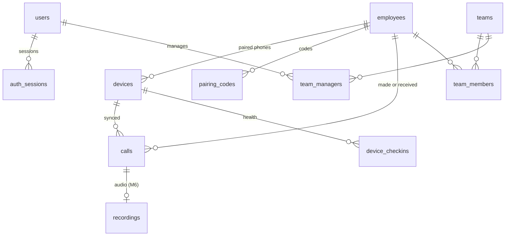

# Data model and API

Every table and route on one page: what each milestone adds, and the conventions they all follow. Each milestone's spec has the full detail for its own tables and routes. When a spec changes a table or route, update this file in the same commit; if the two disagree, the spec wins until this file is fixed.

Last reviewed: 11 November 2026. The database moves from PostgreSQL to MariaDB 11.8 and every company-data table gains `company_id` in P1 (decisions D10 and D11; see [P1's spec](milestones/p1-mariadb-and-companies/spec.md) for the type mapping). The tables below show the columns; P1's changes are listed under "Companies (P1)".

## Conventions

| Topic | Rule |
| --- | --- |
| Database | MariaDB 11.8 from P1 (PostgreSQL 16 until then). Our own database, separate from the CRM's. |
| IDs | `uuid` with `default uuid()` (`gen_random_uuid()` until P1). High-volume append tables (`calls`, `device_checkins`, `audit_logs`, `webhook_deliveries`) use `bigint unsigned auto_increment`. `companies.id` is the CRM's company number, set by hand. |
| Phone numbers | Digits with country code, no plus: `919812345678`. A 10-digit Indian mobile gets `91` added; anything else (landline, toll-free, short code, private number) is stored as the phone gave it, digits only, and flagged `number_kind`. |
| Times | Stored in UTC: `datetime(3)` with the connection's time zone set to `+00:00` (`timestamptz` until P1). Days, hours and "yesterday" are India time, `+05:30`; India has no daylight saving, so a fixed offset is used and the server needs no time-zone tables. |
| Durations | Whole seconds in `int`. |
| Companies | Every company-data table has `company_id` (D11). Access: `super_admin` picks one company and sees what its admin sees; `admin` sees their company; `manager` sees employees in their teams (M2). Every employee-data query goes through one scope function, company first, then role. A device's company comes from its row, never from the request. Reports never add up several companies. |
| Migrations | New numbered file only; never edit a merged one; only add tables, nullable columns and indexes. Claim the number in the tracker's registry first. |
| Routes | `/api/...` for the panel (session cookie); `/device/v1/...` for the app (device token); `/v1/...` for the CRM (API key, M5); public: `/healthz`, `/api/auth/login`, `/i/:code` (install page), `/app/latest.apk`. A route-walking test fails CI for any other pattern. |
| Errors | `{ "error": "<CODE>", "message": "<text>" }`, with `details` for field errors on 400. |
| Schemas | Request and response bodies are Zod schemas in `packages/shared`. The app's Kotlin models are checked against the same JSON examples in tests. |
| Lists | `limit` (default 50, maximum 500) and `cursor`, returning `{ items, nextCursor }`. |
| Filters | One call filter shape shared by history, every report and the export (below). |

### The call filter

Used by `/api/calls`, `/api/reports/*`, the CSV export and `/v1/*`.

| Field | Type | Notes |
| --- | --- | --- |
| `from`, `to` | ISO time | Required. Call start time. At most 180 days apart. |
| `syncedFrom`, `syncedTo` | ISO time | Optional; for the CRM to fetch "what arrived since". |
| `employeeIds` | uuid[] | Optional |
| `teamIds` | uuid[] | Optional (M2) |
| `types` | `incoming`, `outgoing`, `missed`, `rejected` | Optional |
| `minTalk`, `maxTalk` | seconds | Optional, inclusive |
| `minRing`, `maxRing` | seconds | Optional, inclusive |
| `numbers` | string[] | Outside numbers, normalised before matching |
| `recording` | `yes`, `missing` | Calls with an uploaded recording, or flagged as missing one (M6) |
| `commented` | `yes`, `no` | `no`: placed or answered calls still waiting for the after-call form; `yes`: calls with one (M4) |
| `includeExcluded` | boolean | Default false (M2) |
| `hasRecording` | `yes`, `no`, `missing`, `pending` | M6 |

## How the tables connect

## Tables

### Companies (P1)

| Table or change | Columns | Milestone |
| --- | --- | --- |
| `companies` | `id int unsigned primary key` (the CRM's company number), `name`, `status` (`active`, `suspended`), `created_at` | P1 |
| `company_id int unsigned not null` | Added to `employees`, `pairing_codes`, `devices`, `calls`, `teams`, `team_members`, `team_managers`, `excluded_numbers`, `daily_employee_stats`, and every later company-data table (`device_checkins`, `recordings`, `api_keys`, `webhooks` and so on) | P1 onwards |
| `company_id null` | `users` (null for a super admin), `audit_logs` (null for system events), `jobs` (null for jobs not about one company) | P1 |
| Uniqueness | `employees.company_number` unique across all companies; `emp_code`, `teams.name` unique within a company; `excluded_numbers` primary key (`company_id`, `number`); `users.email` unique across all companies | P1 |
| Indexes | Start with `company_id` where reports filter, for example `calls (company_id, employee_id, started_at)` | P1 |

`users.role` gains `super_admin`. `app_releases` stays shared by all companies (one app for everyone).

### Legal sign-off (P1.8, D12)

| Table or change | Columns | Milestone |
| --- | --- | --- |
| `company_agreements` | `id`, `company_id`, `kind` (`data_processing`), `version`, `signed_on date`, `signed_by_name`, `signed_by_title`, `document_ref` (where the signed copy is kept; an R2 object key once R2 is connected), `recorded_by`, `created_at`, `superseded_at` | P1 |
| `consent_texts` | `id`, `company_id`, `version`, `language`, `body`, `published_by`, `published_at`. Unique (`company_id`, `version`). Never edited after publishing | P1 |
| `employee_consents` | `id bigint`, `company_id`, `employee_id`, `device_id`, `consent_text_id`, `accepted_at`, `app_version`, `withdrawn_at null`, `withdraw_reason null` | P1 |
| `employees` (new columns) | `policy_signed_at null`, `policy_document_ref null`, `policy_recorded_by null` | P1 |

A company's devices sync only while it has a current agreement, the employee has `policy_signed_at`, and the device's latest consent is for the company's current `consent_texts` version and not withdrawn.

### Access (M1, M2)

| Table | Columns | Milestone |
| --- | --- | --- |
| `users` | `id`, `email unique`, `name`, `role` (`admin`, `manager`), `password_hash` (argon2id), `disabled_at`, `failed_login_count`, `login_locked_at`, `created_at` | M1 (`manager` used from M2) |
| `auth_sessions` | `id`, `user_id`, `token_hash unique`, `created_at`, `last_seen_at`, `expires_at`, `revoked_at`, `user_agent`, `ip_address` | M1 |
| `audit_logs` | `id bigint`, `user_id null`, `device_id null`, `action`, `target_type`, `target_id`, `details jsonb`, `created_at` | M1 |

### Employees and phones (M1)

| Table | Columns | Milestone |
| --- | --- | --- |
| `employees` | `id`, `name`, `emp_code null unique`, `company_number` (digits), `crm_employee_id null unique` (M5), `status` (`active`, `left`), `created_at`, `left_at` | M1 |
| `pairing_codes` | `id`, `employee_id`, `code_hash`, `expires_at`, `used_at`, `created_by` | M1 |
| `devices` | `id`, `employee_id`, `token_hash unique`, `brand`, `model`, `android_version`, `sdk_int`, `app_version`, `default_dialer`, `sim_slot`, `sim_carrier`, `phone_account_id`, `consent_at`, `consent_version`, `paired_at`, `revoked_at`, `last_sync_at`, `last_checkin_at` | M1 (`last_checkin_at` from M4) |

An employee has at most one active device; pairing a new phone revokes the old one.

### Calls (M1)

| Table | Columns | Milestone |
| --- | --- | --- |
| `calls` | `id bigint`, `employee_id`, `device_id`, `device_call_id` (the call log's row ID), `number`, `number_kind`, `contact_name null`, `type`, `started_at`, `talk_seconds`, `ring_seconds null`, `ended_at null`, `note null` (M4), `synced_at`, `updated_at`. Unique (`device_id`, `device_call_id`). Indexes: (`employee_id`, `started_at`), (`number`, `started_at`), (`synced_at`) | M1 |

### Reports (M2)

| Table | Columns | Milestone |
| --- | --- | --- |
| `teams` | `id`, `name unique`, `created_at` | M2 |
| `team_members` | `team_id`, `employee_id` | M2 |
| `team_managers` | `team_id`, `user_id` | M2 |
| `excluded_numbers` | `number primary key`, `label`, `created_by`, `created_at` | M2 |
| `daily_employee_stats` | `employee_id`, `day date`, counts and seconds per call type, `connected`, `unique_numbers`, `first_call_at`, `last_call_at`, `active_seconds`, `idle_seconds`, `computed_at`. Primary key (`employee_id`, `day`). Recomputed for any day a synced call touches. | M2 |

### Email (M3)

| Table | Columns | Milestone |
| --- | --- | --- |
| `email_outbox` | `id`, `to_address`, `subject`, `body_html`, `kind`, `status` (`queued`, `sent`, `failed`), `attempts`, `last_error`, `created_at`, `sent_at` | M3 |
| `report_subscriptions` | `user_id`, `kind` (`daily`), `enabled` | M3 |

### Phone health and updates (M4)

| Table | Columns | Milestone |
| --- | --- | --- |
| `device_checkins` | `id bigint`, `device_id`, `at`, `battery_pct`, `battery_optimised bool`, `permissions jsonb`, `sim_present bool`, `pending_calls int`, `default_dialer`, `app_version` | M4 |
| `call_outcomes` | `id`, `company_id`, `label` (unique per company), `sort_order`, `active`, `created_at`. Every company starts with Interested, Call back later, Not interested, No answer / busy, Wrong number, Other (migration 0004; new companies get them when created) | M4 (built 11 November 2026) |
| `calls` (new columns) | `outcome_id null` (composite foreign key to the company's outcomes), `follow_up_at null`, `commented_at null`; the comment is `calls.note` | M4 (built 11 November 2026) |
| `app_releases` | `id`, `version_code unique`, `version_name`, `sha256`, `file_key`, `min_supported_code`, `notes`, `published_at` | M4 |

### CRM integration (M5)

| Table | Columns | Milestone |
| --- | --- | --- |
| `api_keys` | `id`, `name`, `key_hash unique`, `prefix`, `created_by`, `created_at`, `revoked_at`, `last_used_at` | M5 |
| `webhooks` | `id`, `url`, `secret_encrypted`, `events text[]`, `enabled`, `created_at` | M5 |
| `webhook_deliveries` | `id bigint`, `webhook_id`, `event`, `payload jsonb`, `status`, `attempts`, `next_attempt_at`, `last_status_code`, `created_at` | M5 |

### Recordings (M6)

| Table | Columns | Milestone |
| --- | --- | --- |
| `recordings` | `id`, `company_id`, `call_id unique` (composite foreign key to the company's call), `status` (`pending_upload`, `uploaded`, `missing`), `object_key` (R2 key `c<company>/<yyyy>/<mm>/<call id>-<random>.<ext>`), `size_bytes`, `audio_seconds`, `mime_type`, `match_score` (0 to 100), `reported_at`, `uploaded_at`, `deleted_at`. Audio is never in the database. Built 11 November 2026 (migration 0005) | M6 |
| (plays) | Each play is an `audit_logs` row `recording.played`; no separate table | M6 |

### Call from the app (M9)

| Table | Columns | Milestone |
| --- | --- | --- |
| `call_requests` | `id`, `company_id`, `employee_id`, `device_id`, `number`, `crm_lead_id null`, `requested_at`, `call_id null` (set when the synced call matches by number and time) | M9 |
| `calls` (new columns) | `started_from_app bool`, `crm_lead_id null` | M9 |

### Jobs (M2)

| Table | Columns | Milestone |
| --- | --- | --- |
| `jobs` | `id bigint`, `kind`, `payload json`, `run_at`, `locked_at`, `attempts`, `last_error`, `done_at`. Workers take jobs with `for update skip locked` (MariaDB 10.6+ supports it). On shared hosting, hPanel cron runs the worker for a short time every minute (D10). | M2 |

## API

### Panel (`/api`, session cookie)

| Method | Route | Who | Milestone |
| --- | --- | --- | --- |
| POST | `/api/auth/login`, `/api/auth/logout` | anyone, logged in | M1 |
| GET | `/api/auth/me` | logged in | M1 |
| GET, POST | `/api/call-outcomes`; PATCH `/api/call-outcomes/:id` (label, sortOrder, active) | admin | M4 (built 11 November 2026) |
| GET, POST | `/api/companies` | super admin | P1 |
| PATCH | `/api/companies/:id` | super admin | P1 |
| GET, POST | `/api/employees` | admin (managers read their teams' from M2) | M1 |
| GET, PATCH | `/api/employees/:id` | admin | M1 |
| POST | `/api/employees/:id/pairing-code` | admin | M1 |
| POST | `/api/employees/:id/revoke-device` | admin | M1 |
| GET | `/api/calls` (call filter) | admin; manager from M2 | M1 |
| GET | `/api/calls/export.csv` (call filter) | admin; manager from M2 | M1 |
| GET | `/api/reports/summary`, `/employees`, `/analysis`, `/never-attended`, `/not-picked-up`, `/unique-numbers`, `/hourly`, `/daywise` (call filter) | admin, manager | M2 |
| GET, POST, DELETE | `/api/teams`, `/api/excluded-numbers`, `/api/users` | admin | M2 |
| GET | `/api/devices` (health list) | admin, manager | M4 |
| POST | `/api/app-releases` | admin | M4 |
| GET, POST, DELETE | `/api/integrations/api-keys`, `/api/integrations/webhooks` | admin | M5 |
| GET | `/api/calls/:id/recording` (returns a 5-minute play link; 410 `RECORDING_EXPIRED` after 365 days, D4). Built 11 November 2026 | admin, manager | M6 |

### Phone app (`/device/v1`, `Authorization: Bearer <device token>`)

| Method | Route | Purpose | Milestone |
| --- | --- | --- | --- |
| POST | `/device/v1/pair` | Body: `{ code, brand, model, androidVersion, sdkInt, appVersion, defaultDialer, simSlot, simCarrier, phoneAccountId, consentVersion }`. No token needed. Returns `{ deviceToken, employee: { name, companyNumber }, settings }` | M1 |
| POST | `/device/v1/calls` | Batch of up to 200 calls. Returns `{ accepted, duplicates }`. Idempotent on (`device`, `deviceCallId`) | M1 |
| GET | `/device/v1/config` | Settings, the company's active outcomes for the after-call form (built 11 November 2026), latest app version | M1 (outcomes and version from M4) |
| POST | `/device/v1/checkin` | Health snapshot | M4 |
| PATCH | `/device/v1/calls/:deviceCallId/comment` | After-call form `{ outcomeId, note, followUpAt }` (any may be null, but not both outcome and note). 404 `CALL_NOT_SYNCED` until the call has arrived; the phone keeps the comment and retries. Built 11 November 2026 | M4 |
| POST | `/device/v1/call-requests` | Record that the app is about to place a call | M9 |
| GET | `/device/v1/leads` | The employee's CRM leads to call | M9 |
| POST | `/device/v1/recordings/upload-url` | `{ deviceCallId, sizeBytes, mimeType, audioSeconds, matchScore }` → `{ uploadUrl, expiresAt, headers }`; a 15-minute signed PUT link straight to R2. 503 `RECORDINGS_NOT_CONFIGURED` until R2 is set; 409 `RECORDING_EXISTS` | M6 (built) |
| POST | `/device/v1/recordings/complete` | Confirms the upload; the server checks the object's size in R2 (400 `UPLOAD_NOT_FOUND` if absent) | M6 (built) |
| POST | `/device/v1/recordings/missing` | Marks a call's recording missing; never overwrites an upload | M6 (built) |

A revoked device gets 401 `DEVICE_REVOKED` and the app stops syncing and shows "This phone was unpaired".

### Public

| Method | Route | Purpose | Milestone |
| --- | --- | --- | --- |
| GET | `/healthz` | `{ status, db }` | M0 |
| GET | `/i/:code` | Install page: download button, the 6-digit code, steps | M1 |
| GET | `/app/latest.apk` | Latest APK | M1 |

### CRM (`/v1`, `Authorization: Bearer <API key>`, M5)

The same reports and history as the panel, in Callyzer's shape so the CRM gets everything it would from Callyzer: `POST /v1/reports/summary`, `/employees`, `/analysis`, `/never-attended`, `/not-picked-up`, `/unique-numbers`, `/hourly`, `/daywise`; `POST /v1/calls/search`; `POST /v1/calls/stream` (NDJSON); `GET /v1/calls/:id`; `GET, PUT /v1/employees` (the CRM pushes its employees); `GET /v1/calls/:id/recording` (M6). POST is used for searches because the call filter has arrays. Rate limit 5 requests a second per key. Webhook events: `call.synced`, `recording.uploaded`, `recording.missing`, `device.unhealthy`; signed with HMAC-SHA256 in `X-Signature`, retried with backoff for 24 hours.

### Error codes

| Code | Status | When |
| --- | --- | --- |
| `INVALID_REQUEST` | 400 | Body or query fails validation |
| `RANGE_TOO_LONG` | 400 | Filter spans more than 180 days |
| `UNAUTHENTICATED` | 401 | No or bad session |
| `INVALID_CREDENTIALS` | 401 | Wrong email or password |
| `DEVICE_REVOKED` | 401 | Device token revoked |
| `PAIRING_CODE_INVALID` | 400 | Code wrong, used or expired |
| `FORBIDDEN` | 403 | Role not allowed |
| `NOT_FOUND` | 404 | Unknown ID, or another team's data for a manager, or another company's data (P1) |
| `NUMBER_IN_USE` | 409 | The company SIM number already belongs to another employee, in any company (P1) |
| `COMPANY_SUSPENDED` | 403 | The company is suspended; its devices stop syncing and its users cannot log in (P1) |
| `COMPANY_AGREEMENT_MISSING` | 409 or 403 | No current company agreement: pairing code refused (409), device sync refused (403) (P1.8) |
| `EMPLOYEE_POLICY_MISSING` | 409 | Pairing code asked for an employee without a recorded signed policy (P1.8) |
| `RECORDINGS_NOT_CONFIGURED` | 503 | Storage settings not set on the server; the phone keeps the recording and retries (M6) |
| `RECORDING_EXISTS` | 409 | The call already has its recording (M6) |
| `UPLOAD_NOT_FOUND` | 400 | "Complete" before the file arrived in storage (M6) |
| `NO_RECORDING` | 404 | The call has no uploaded recording (M6) |
| `RECORDING_EXPIRED` | 410 | Older than 365 days; R2's lifecycle rule has deleted it (D4) |
| `CALL_NOT_SYNCED` | 404 | After-call form for a call the server does not have yet (M4) |
| `OUTCOME_UNKNOWN` | 400 | Outcome switched off or from another company (M4) |
| `OUTCOME_EXISTS` | 409 | An outcome with that label already exists in the company (M4) |
| `CONSENT_REQUIRED` | 403 | Device syncing without consent to the company's current consent text (P1.8) |
| `LOGIN_LOCKED` | 423 | Too many wrong passwords |
| `RATE_LIMITED` | 429 | CRM API over its limit |
