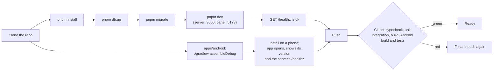

# M0. Foundation

- Status: Not started
- Owner: unassigned
- Starts after: nothing
- External prerequisites: none

## Outcome

A developer can clone the repo, start PostgreSQL, the server and the panel on a laptop, build and install a debug APK on a phone, and push to the work branch with CI checking everything. M0 has no product features.

## Flow diagram

## Worked example

Priya clones the repo, runs the five commands in the README, opens http://localhost:3000/healthz and sees `{"status":"ok","db":"ok"}`. She builds the debug APK, installs it on her Samsung over USB, types her laptop's address into the app's developer screen, and the app shows "Server ok". She pushes a one-line change and CI runs both the Node and the Android checks.

## Scope

In:

- pnpm monorepo copied in shape from `reaplift-bsp`: `apps/server` (Fastify, `MODE`, pino, Zod, Kysely), `apps/web` (React + Vite, empty shell), `packages/shared`, `infra/compose.dev.yml` (PostgreSQL 16; MinIO added in M6), `db/migrations/0001_init.sql`, migration runner, `.env.example`, ESLint, Prettier, Vitest
- `apps/android`: Kotlin, Jetpack Compose, Gradle version catalog, minimum Android 10 (D7), target the newest stable SDK; a developer screen that sets the server address and calls `/healthz`; JUnit and Robolectric tests
- CI (GitHub Actions): Node lint, typecheck, unit and integration tests against PostgreSQL 16, build; Android `assembleDebug`, `test`, `lint`
- README with local setup for Mac

Out: deploy, HTTPS and backups (M7); APK signing for release (M1 task 1.7).

## Tasks

| Task | Name | Depends on | Can run in parallel with |
| --- | --- | --- | --- |
| 0.1 | Server, panel and shared scaffold | none | 0.3 |
| 0.2 | Migrations and `/healthz` | 0.1 | 0.3 |
| 0.3 | Android scaffold | none | 0.1, 0.2 |
| 0.4 | CI | 0.1 to 0.3 | none |

### 0.1 Server, panel and shared scaffold

- Acceptance: `pnpm dev` starts both; `pnpm test` and `pnpm build` pass.

### 0.2 Migrations and `/healthz`

- `pnpm migrate` applies `db/migrations/*.sql` in order and records them; running it twice changes nothing.
- Acceptance: `/healthz` reports the database state, and `db: "down"` when PostgreSQL is stopped.

### 0.3 Android scaffold

- Acceptance: `./gradlew assembleDebug test lint` passes; the debug APK installs on a phone and reaches `/healthz` on the laptop over Wi-Fi.

### 0.4 CI

- Runs on every push to the work branch and on pull requests into `main`.
- Acceptance: a failing test in either the Node or Android part turns CI red.

## Data and API

- `0001_init.sql`: `schema_migrations` only.
- `GET /healthz` → `{ "status": "ok", "db": "ok" | "down" }`.
- Settings: `DATABASE_URL`, `PORT`, `MODE`, `LOG_LEVEL`.

## Open questions

- The work branch's name and whether the repo goes on GitHub under `reaplift` now (owner).

## Demo (milestone acceptance)

1. On a clean Mac, follow the README; `/healthz` is ok.
2. Install the debug APK on a phone; it shows "Server ok".
3. Push a commit with a failing test; CI is red. Revert; CI is green.
