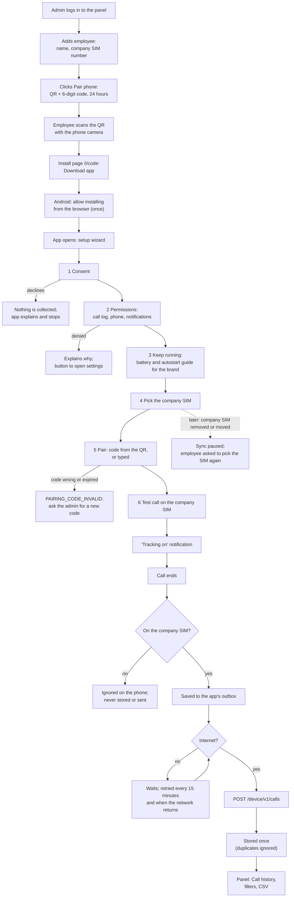

# M1. Install the app and see call history

- Status: Built on 8 November 2026 and run end to end on the Android 15 emulator ([test-evidence.md](test-evidence.md)). Done after the demo on real Samsung, Oppo and Vivo phones, including a dual-SIM phone (E1), and release signing (1.8).
- Owner: unassigned
- Starts after: M0
- External prerequisites: E1 (test phones: Samsung, Oppo, Vivo, and a dual-SIM phone with a second SIM)

## Outcome

An admin adds an employee in the panel and clicks Pair phone. The employee scans a QR code, installs the app, goes through a short setup, and from then on every call on their company SIM appears in the panel's call history within a minute, with type, number, contact name, time, talk time and ringing time. Calls on their personal SIM never leave the phone and are never stored. (Changed on 11 November 2026 by D14: there is no matching against business contacts or leads.) The admin can filter the history and download it as CSV.

The owner asked for this to be easy to install (7 November 2026), so the install is measured: a first-time employee should finish setup in under 5 minutes without help.

## Flow diagram



## Worked example

- Admin: `nikhila@reaplift.com`.
- Employee: **Ravi Kumar**, company SIM `919812345678` in slot 2 of his Vivo Y-series phone (Android 14); his personal SIM `917700011122` is in slot 1.

1. Nikhila adds Ravi with company number `9812345678`; the panel stores `919812345678`. She clicks **Pair phone**; the panel shows a QR code and the code `482 913`, valid until 10:15 tomorrow.
2. Ravi scans the QR. The page says "Install ReapLift Call Tracker" with a Download button and three numbered steps. He downloads it, Android asks to allow installs from Chrome, he allows it and installs.
3. The wizard: he taps **I agree** on consent; grants call log, phone and notifications; the Vivo guide shows where to turn on "Allow background activity" and he does; the SIM screen shows "SIM 1 Airtel" and "SIM 2 Jio", with "Your company number: 98123 45678", and he picks SIM 2. The code `482 913` is filled in from the QR; pairing succeeds and shows "Paired as Ravi Kumar".
4. The test call step: he calls a colleague on SIM 2 for 20 seconds. Within a minute the wizard shows "Test call synced ✓". Setup took him 4 minutes.
5. In the afternoon Ravi makes these calls:

| Time | SIM | Number | What happened |
| --- | --- | --- | --- |
| 14:02 | SIM 2 (company) | 919900011111 (saved as "Sharma Traders") | Outgoing, rang 12 s, talked 3 min 05 s |
| 14:10 | SIM 2 | 918800022222 | Outgoing, rang 30 s, no answer |
| 14:25 | SIM 2 | 919900011111 | Incoming, missed |
| 14:40 | SIM 1 (personal) | 917000033333 | Outgoing to his family, 6 min |
| 15:00 | SIM 2 | 919900011111 | Incoming, answered after 8 s, talked 1 min 10 s |

6. Nikhila opens **Call history**, filters to Ravi and today: she sees exactly four rows (14:02, 14:10, 14:25, 15:00). The 14:40 personal call is not there and is not in the database.
7. She filters "type = outgoing" and sees two rows; "minimum talk 60 s" shows the 14:02 and 15:00 calls. She downloads the CSV and it has the same rows.
8. Ravi's mobile data is off from 16:00 to 16:30, and he makes a company-SIM call at 16:10. It waits in the app's outbox and appears in the panel shortly after 16:30.
9. The server restarts at 17:00; nothing is lost. Ravi's 16:10 call is sent twice because the first response was lost; the panel shows it once.

## Scope

In:

- Panel login for admins (argon2id passwords, httpOnly cookie, lockout), copied from `reaplift-bsp` M1. Admins are created with `cli create-user`.
- Employees: list, add, edit, mark as left. Pairing codes, revoke a phone.
- Install page and APK download.
- The app: setup wizard, company SIM selection and SIM safety, call-log sync with outbox and retries, ringing time, the foreground service, a simple home screen (status, last sync, "what was synced": today's company-SIM calls as the server has them).
- Call history page with the call filter (from M2's teams and excluded numbers onward, more filters appear) and CSV export.
- The privacy test.

Out:

- Reports, teams, managers, excluded numbers: [M2](../m2-call-reports/spec.md)
- Device health page, check-ins, self-update, note after a call, dialer detection beyond recording it at pairing: [M4](../m4-phone-health-and-updates/spec.md)
- Recordings: [M6](../m6-call-recordings/spec.md)
- Server on the internet: [M7](../m7-deploy/spec.md). M1's demo runs with the phone on the same Wi-Fi as the laptop or through a tunnel.

## Tasks

| Task | Name | Depends on | Can run in parallel with |
| --- | --- | --- | --- |
| 1.1 | Admin login | none | 1.4 |
| 1.2 | Employees and pairing codes (server and panel) | 1.1 | 1.4 |
| 1.3 | Install page and APK download | 1.2 | 1.4 |
| 1.4 | App: setup wizard and company SIM | none (against a stub server) | 1.1 to 1.3 |
| 1.5 | App: call-log sync, outbox, ringing time | 1.4 | 1.6 |
| 1.6 | Server: device API and call storage | 1.2 | 1.5 |
| 1.7 | Call history page and CSV | 1.6 | 1.5 |
| 1.8 | Release APK signing and the brand guides | 1.4 | 1.5 to 1.7 |
| 1.9 | Privacy test and real-phone runs | 1.5, 1.6 | 1.7 |

### 1.1 Admin login

- Users, sessions, logout, lockout (5 wrong in a row locks for 24 hours; `cli unlock-user`), Origin check on state-changing requests. As in `reaplift-bsp` M1, without client workspaces.
- Tests: wrong password 401; lockout; session survives a restart; logged-out cookie gives 401.
- Acceptance: an admin made with `cli create-user` logs in and out.

### 1.2 Employees and pairing codes

- Add, edit, list, mark as left. The company number is normalised (`9812345678` → `919812345678`); a number already used by an active employee is refused with `NUMBER_IN_USE`.
- **Pair phone** creates a code: 6 random digits, stored hashed, valid 24 hours (setting), single use. Creating a new code invalidates the old one. The panel shows the code and a QR of `https://<server>/i/<code>`.
- **Revoke phone** sets `revoked_at`; the device's next request gets `DEVICE_REVOKED`.
- Audit: employee created, edited, left; code created; phone paired; phone revoked.
- Tests: normalisation; duplicate number; code expiry and single use; revoked token refused.
- Acceptance: the worked example's step 1 in the panel.

### 1.3 Install page and APK download

- `GET /i/:code` (public): a phone-sized page with the employee's first name, a Download button, the 6-digit code in large digits, and three steps with pictures ("Allow install", "Open", "Follow the steps"). An expired or used code shows "Ask your admin for a new code" and no download.
- `GET /app/latest.apk` serves the current signed APK from a folder set by `APK_DIR`.
- As built: after installing, the employee goes back to the page and taps **Open the app**, an `intent://` link that opens the app with `reaplift-calls://pair?code=…&server=…`, filling in the code (and, in debug builds, the server). Before the app is installed the same link falls back to the download. The code is also shown to type by hand. A release build only accepts its own built-in server from a link.
- Tests: page for a valid, expired and used code; APK served with the right content type.
- Acceptance: on each test phone, from QR scan to app open with no other help.

### 1.4 App: setup wizard and company SIM

- The six steps in the flow diagram. Each can be resumed if the employee leaves the app; the home screen shows what is left.
- Consent text (versioned, `CONSENT_VERSION`): what is collected (calls on the company SIM: number, contact name, time, type, talk and ringing time; from M6, recordings of those calls), what is never collected (personal-SIM calls, messages, contacts, location, other apps), who sees it (ReapLift admins and the employee's managers), how long it is kept (D4). The owner approves the text before the demo.
- Permissions: `READ_CALL_LOG`, `READ_PHONE_STATE`, `POST_NOTIFICATIONS`. A denied permission shows why it is needed and a button to the app's settings.
- Keep running: requests "ignore battery optimisation"; shows the guide for the phone's brand (Samsung, Oppo, Vivo first; others get a general guide) with a button that opens the right settings screen where the brand allows it.
- Company SIM: lists active SIMs (slot, carrier, and the number if Android reports it). If Android reports a number for a SIM that equals the employee's company number, that SIM is preselected. Stores the SIM's subscription ID and the phone-account ID the call log uses for it (see T1 in open-questions.md).
- Pairing: `POST /device/v1/pair` with the code and the phone's details (brand, model, Android version, app version, default dialer, SIM slot and carrier). The token is encrypted with a key held in Android's keystore.
- Test call: waits for one company-SIM call to sync; "Skip for now" is allowed but leaves a "Test call not done" banner.
- Tests (Robolectric): wizard resumes at the right step; consent declined stores nothing; SIM preselection; pairing error shows the right message.
- Acceptance: worked example steps 2 to 4 on each test phone, timed.

### 1.5 App: call-log sync, outbox, ringing time

- Content observer on the call log plus a WorkManager job every 15 minutes and on boot. Each run reads call-log rows newer than the last one read, keeps only those whose phone account matches the company SIM before writing them to the outbox (plain SQLite, not Room: Room needs a code generator, KSP, that the week's timetable did not need).
- Which call-log rows are the company SIM's: the subscription ID, plus on Android 11+ every calling account Android maps to that SIM. A row with no SIM is accepted only on a single-SIM phone.
- **No lead or contact filter** (D14, 11 November 2026): every company-SIM call is kept, whoever the other number is. Personal-SIM calls are dropped on the phone before anything is stored for upload. The built app already works this way.
- On first pairing, reads the last 7 days (D3) of company-SIM calls.
- Sends the outbox in batches of up to 200, oldest first; a row leaves the outbox only after the server accepts it. Exponential backoff on failure.
- Ringing time: the foreground service listens to call-state changes for the company SIM's subscription and stores each call's end time; ringing = (end − start) − talk, or empty if the service was not running.
- Type mapping: incoming, outgoing, missed, rejected; blocked counts as rejected; voicemail and other types are skipped.
- SIM safety: before each run, the app checks the chosen SIM is still present with the same IDs. If not, it pauses, shows a notification "Pick your company SIM again", and reads nothing until the employee does.
- Foreground service type `specialUse` (Android 15 limits `dataSync` to 6 hours a day); to confirm over a full day on the test phones (T3).
- Tests: a fake call log with both SIMs' rows yields only company-SIM rows; unassigned or personal calls are dropped before upload; outbox keeps rows on a 500 response and removes them on 200; ringing-time arithmetic; SIM change pauses sync.
- Acceptance: worked example steps 5, 8 and 9.

### 1.6 Server: device API and call storage

- `POST /device/v1/pair`, `POST /device/v1/calls`, `GET /device/v1/config` as in [data-model-and-api.md](../../data-model-and-api.md).
- Calls are inserted with `on conflict (device_id, device_call_id) do update` only for fields that can change (contact name, ringing time), and `updated_at` set. The response counts accepted and duplicates.
- A call is rejected (400) if its `startedAt` is more than 1 day in the future, or more than D3 days before pairing. Numbers are normalised as in the conventions.
- Device token check on every `/device/v1` route except `pair`; `DEVICE_REVOKED` for revoked ones. `last_sync_at` updated on every accepted batch.
- Tests: duplicates counted not stored; revoked token; validation errors; a batch of 200 in under 1 second locally.
- Acceptance: the worked example's rows are in `calls` exactly once.

### 1.7 Call history page and CSV

- Columns: date and time, employee, number (and contact name), type, talk time, ringing time, synced at. Newest first, cursor pages of 50.
- Filters: date range (default today), employee, type, minimum and maximum talk, minimum and maximum ringing, number. 180-day limit.
- CSV export of the filtered rows, streamed, with India times.
- Tests: each filter against a fixed data set; CSV matches the page's rows.
- Acceptance: worked example steps 6 and 7.

### 1.8 Release APK signing and the brand guides

- Release builds signed with ReapLift's key from CI secrets (team-workflow.md). `versionCode` increases per release.
- Brand guide screens for Samsung, Oppo and Vivo, written from the test phones with screenshots.
- Acceptance: the signed APK installs over the previous version on each test phone without losing pairing.

### 1.9 Privacy test and real-phone runs

- An automated test feeds the sync code a call log with rows for both SIMs and asserts that nothing from the other SIM reaches the outbox or the network.
- On the dual-SIM test phone, calls on both SIMs, then SQL proves only company-SIM calls are stored.
- Answer T1 to T3 in open-questions.md for each test phone.
- Acceptance: evidence in `android.md` and `test-evidence.md` with phone models and Android versions.

## Data and API

Migration 0002 (`0002_employees_devices_calls.sql`): `users`, `auth_sessions`, `audit_logs`, `employees`, `pairing_codes`, `devices`, `calls`, as in [data-model-and-api.md](../../data-model-and-api.md).

| Method | Route | Who | Success | Errors |
| --- | --- | --- | --- | --- |
| POST | `/api/auth/login` | anyone | 200 user; sets cookie | 400, 401 `INVALID_CREDENTIALS`, 423 `LOGIN_LOCKED` |
| POST | `/api/auth/logout` | logged in | 204 | 401 |
| GET | `/api/auth/me` | logged in | 200 user | 401 |
| GET, POST | `/api/employees` | admin | 200 list, 201 created | 400, 409 `NUMBER_IN_USE` |
| PATCH | `/api/employees/:id` | admin | 200 | 400, 404, 409 |
| POST | `/api/employees/:id/pairing-code` | admin | 201 `{ code, expiresAt, installUrl }` | 404 |
| POST | `/api/employees/:id/revoke-device` | admin | 204 | 404 |
| GET | `/api/calls` | admin | 200 `{ items, nextCursor }` | 400 `RANGE_TOO_LONG` |
| GET | `/api/calls/export.csv` | admin | 200 CSV | 400 |
| GET | `/i/:code` | public | 200 HTML | 200 "ask for a new code" |
| GET | `/app/latest.apk` | public | 200 APK | 404 |
| POST | `/device/v1/pair` | app | 201 `{ deviceToken, employee, settings }` | 400 `PAIRING_CODE_INVALID` |
| POST | `/device/v1/calls` | device | 200 `{ accepted, duplicates }` | 400, 401 `DEVICE_REVOKED` |
| GET | `/device/v1/config` | device | 200 settings | 401 |

Call in a batch:

```json
{
  "deviceCallId": "4182",
  "number": "+91 99000 11111",
  "contactName": "Sharma Traders",
  "type": "outgoing",
  "startedAt": "2026-11-09T08:32:00Z",
  "talkSeconds": 185,
  "ringSeconds": 12,
  "endedAt": "2026-11-09T08:35:17Z"
}
```

Settings: `SESSION_COOKIE_SECURE`, `PANEL_ORIGIN`, `PUBLIC_BASE_URL`, `APK_DIR`, `PAIRING_CODE_HOURS` (24), `INITIAL_SYNC_DAYS` (7). The consent version is in the app (`CONSENT_VERSION` in `ui/Consent.kt`) and sent with pairing.

As built, also:

- `POST /device/v1/calls` answers `{ accepted, duplicates, rejected: [{ deviceCallId, reason }] }`; the phone drops rejected calls from its outbox instead of retrying them forever.
- 10 wrong pairing codes from one address in 10 minutes answer 429 `RATE_LIMITED`.
- Marking an employee as left unpairs their phone.
- Local ports: server 3100, panel 5174, database 5433, so `reaplift-bsp` can run alongside.

## Open questions

- D3 (days of past calls at pairing), D5 (our own panel), D7 (lowest Android version): defaults in the tracker.
- T1 to T3: answered on the test phones in task 1.9.
- The consent text: written in 1.4, approved by the owner (Q4).

## Demo (milestone acceptance)

Run on each test phone (Samsung, Oppo, Vivo), recording the model and Android version.

1. Create an admin with `cli create-user`; log in.
2. Add the employee; click Pair phone; record the code and QR.
3. With a stopwatch, a person who has not seen the app before scans the QR and finishes setup. Record the time (target: under 5 minutes) and anything they asked.
4. Make the worked example's five calls (two SIMs on the dual-SIM phone).
5. In the panel, the four company-SIM calls appear within a minute each; SQL shows no row for the personal-SIM number.
6. Apply the filters in step 7 of the worked example; download the CSV.
7. Turn off mobile data, make a company-SIM call, turn it on; the call appears.
8. Restart the server and reboot the phone; make another call; it appears, and nothing is duplicated.
9. Move the company SIM to the other slot; the app pauses and asks to pick the SIM; after picking, sync resumes.
10. Revoke the phone in the panel; the app shows "This phone was unpaired" and stops.
