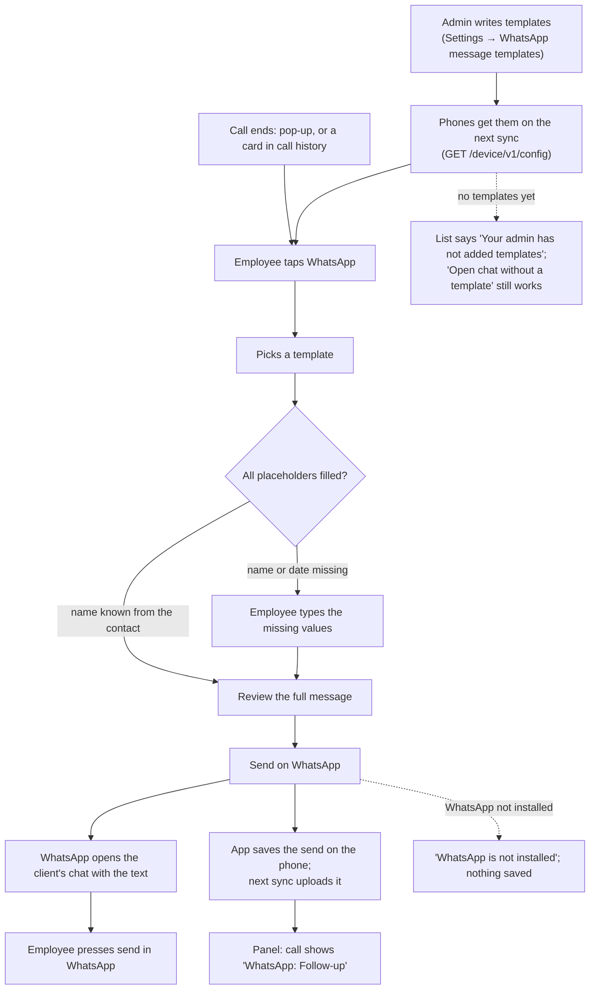

# M10. WhatsApp message templates

- Status: **Built 13 November 2026 (app 0.6.0, server live).** Run end to end on the emulator ([test-evidence.md](test-evidence.md)); real WhatsApp on real phones still to check. W6 used its default: new companies start with no templates. The order the owner set on 12 November 2026 is: approve the design, write this spec, finish the design, then build.
- Owner: unassigned
- Starts after: M4 task 4.5 (after-call pop-up and call history screen, built in app 0.5.0)
- External prerequisites: E1 (test phones with WhatsApp or WhatsApp Business installed)
- Asked by: the client (Country Roads), 12 November 2026, with screenshots of Callyzer's **Manage → Message Templates** page

## Outcome

A company's admin writes a few fixed WhatsApp messages in the panel, for example "Welcome", "Follow-up" and "Not interested, but keep in touch". After a call, or from the app's call history, the employee taps **WhatsApp**, picks one, and sees the message with the client's name already filled in. If the phone doesn't have a name for the number, the app asks the employee to type one. The employee checks the message and taps **Send**. WhatsApp opens on the client's chat with the text ready, and the employee presses WhatsApp's own send button. The panel shows which template was sent to which client, by whom and when.

## Design (to approve)

The screens (and the dashboard's) are in [design-review.html](design-review.html), shared with the client for approval on 12 November 2026.

**How the message is sent: WhatsApp on the employee's phone (recommended).** The app opens WhatsApp with the client's number and the filled-in text (Android's `https://wa.me/<number>?text=<text>` link, aimed at WhatsApp Business if it's installed). This is what Callyzer's Message Templates do ("they can access them through the Callyzer Biz app"). It is free, needs no approval from Meta, and the message comes from the employee's own WhatsApp, so the client can reply to them. The cost of this choice is that the employee must press WhatsApp's send button, and we only know that WhatsApp was opened with the text, not that the message was delivered.

The alternative is the **WhatsApp Business Cloud API**, which sends from one company number with no tap in WhatsApp. It needs Meta business verification, Meta's approval of every template, a paid conversation charge for each message, and a number that can't also be used in the WhatsApp app. Replies come to that central number, not to the employee. It's a separate, later project if a client wants automatic messages.

**Fixed templates, filled-in placeholders.** A template is a title and a text with placeholders in double braces:

| Placeholder | Filled with | If missing |
| --- | --- | --- |
| `{{name}}` | The client's name: the contact name the phone has for the number (later, the CRM lead's name) | The employee must type it |
| `{{employee_name}}` | The employee's name in Callit | Always present |
| `{{company_name}}` | The company's name in Callit | Always present |
| `{{follow_up_date}}` | The follow-up date chosen in the after-call form, as "13 Nov" | The employee picks or types it |

**Custom blanks (client, W5):** the super admin can put any other blank in a template, for example `{{product}}`, `{{site_name}}` or `{{price}}`. The app shows a box for each one, labelled from the blank's name ("Product", "Site name", "Price"), and the employee must fill it before sending. Only the four blanks above are filled automatically.

The employee can't change the template's own words, only fill the blanks. A blank the app can't fill (for example the name of a new client whose number isn't saved) must be filled by the employee. That keeps the wording the super admin wrote (the client asked for "fixed templates").

**Where the employee finds it:**
1. The after-call pop-up's **WhatsApp** button (which today opens a blank chat) opens the template list.
2. The **WhatsApp** button on each card in the app's call history does the same.
3. A blank chat stays one tap away ("Open chat without a template").

**Steps in the app:** pick template → fill the missing values (the name is pre-filled when known) → review the full message → **Send on WhatsApp** → WhatsApp opens with the text → the employee presses send in WhatsApp → back in Callit, the send is saved on the phone and uploaded with the next sync (it works offline, like comments).

**Panel:**
- **Settings → WhatsApp message templates (company admins; the super admin for the company picked):** list (title, text, on/off, last changed), add and edit with buttons that insert each automatic blank, a way to add a custom blank, and a live preview with sample values. Managers see the list but can't change it.
- **Call history:** a "WhatsApp" mark on the call with the template's title, and the message in the call's details.

## Flow diagram

## Worked example

Country Roads' admin adds the template **Follow-up**:

> Hi {{name}}, this is {{employee_name}} from {{company_name}}. Thanks for your time today. As discussed, I'll call you on {{follow_up_date}}. Reply here if anything comes up.

Meena calls `919900011111`, saved on her phone as "Asha Builders", talks 3 minutes, and in the pop-up picks the outcome Interested and the follow-up date Tomorrow (13 Nov). She taps **WhatsApp → Follow-up**. Everything is filled in, so the app goes straight to the review:

> Hi Asha Builders, this is Meena Iyer from Country Roads. Thanks for your time today. As discussed, I'll call you on 13 Nov. Reply here if anything comes up.

She changes the name to "Asha" and taps **Send on WhatsApp**. WhatsApp Business opens on the chat with `+91 99000 11111`, the text ready, and she presses send. In the panel's call history, the 11:00 call to 919900011111 shows "WhatsApp: Follow-up", sent by Meena at 11:04.

Ten minutes later she calls `919900077777`, a number not saved on her phone, and picks **Welcome**. The app asks "Client's name" before showing the review.

## Scope

In:
- Templates per company in the panel (add, edit, switch off; at most 50 active; text up to 1,000 characters).
- The four placeholders above.
- The app's template list, fill-in and review screens, from the pop-up and the call history.
- Opening WhatsApp or WhatsApp Business with the text.
- A log of sends, uploaded with sync, shown in the panel's call history.

Out:
- The WhatsApp Business Cloud API: automatic sending from a central number (a later project if wanted).
- Images, PDFs and locations (a `wa.me` link carries text only; links to a brochure work as text).
- Reading WhatsApp chats or replies (never: the privacy rule covers this).
- Tags that show different templates to different teams (Callyzer has tags; later if wanted).
- WhatsApp sends in the CRM API (Callyzer's API has none; can follow M5's webhooks).

## Tasks (after approval)

| Task | Name | Depends on | Parallel with |
| --- | --- | --- | --- |
| 10.1 | Templates: migration, panel routes, Settings page | approval | 10.2 |
| 10.2 | Placeholder filling, shared and tested on the server and in the app | approval | 10.1 |
| 10.3 | App: template list, fill-in, review, open WhatsApp | 10.1, 10.2 | none |
| 10.4 | Send log: phone outbox, `POST /device/v1/message-sends`, panel call history | 10.3 | none |
| 10.5 | Real phones: WhatsApp and WhatsApp Business, Vivo and Tecno; evidence | 10.4 | none |

Each task ships with its tests: placeholder filling (missing values, braces in text, Unicode such as Telugu and emoji), one company never seeing another's templates or sends, the outbox retrying offline, and the app refusing to open WhatsApp with an unfilled placeholder.

## Data and API

- Migration `message_templates`: `id`, `company_id`, `title varchar(100)`, `body text`, `sort_order`, `active`, `created_by`, `created_at`, `updated_at`. Unique `(company_id, title)`.
- Migration `message_sends`: `id`, `company_id`, `employee_id`, `device_id`, `device_send_id` (unique with device, so a retry is not saved twice), `template_id null`, `number`, `call_id null`, `body` (the text as sent), `app` (`whatsapp` or `whatsapp_business`), `opened_at`, `synced_at`.
- `GET /device/v1/config` adds `messageTemplates: [{ id, title, body }]`.
- `POST /device/v1/message-sends`: a batch from the phone's outbox; `{ accepted, duplicates }`.
- `GET /api/message-templates` (admins; managers read only); `POST, PATCH /api/message-templates` (admins, and the super admin for the company picked).
- `GET /api/calls` adds `whatsapp: [{ templateTitle, sentAt }]`.
- Error codes: `TEMPLATE_EXISTS` (409), `TEMPLATE_BLANK_INVALID` (400: a blank name must be letters, digits and underscores, for example `{{site_name}}`).

## Decisions (client, 12 November 2026)

| | Question | Decision |
| --- | --- | --- |
| W1 | Who writes templates? | **The company's admins** (client, 13 November 2026, changed from the super admin), and the super admin for any company. Managers and employees can't change them |
| W2 | Employee's WhatsApp or a central number through Meta's API? | **The employee's WhatsApp** |
| W3 | Must employees use WhatsApp Business on the company SIM? | **Not required for now.** The app opens WhatsApp Business if installed, otherwise WhatsApp |
| W4 | Can the employee change the wording? | **No, only fill the blanks.** Blanks the app can't fill (for example a new client's name) the employee must fill |
| W5 | Other blanks? | **Any blank the super admin puts in a template** (product, site, price and so on); the employee fills them |
| W6 | Should a new company start with three example templates (Welcome, Follow-up, Not interested) for the super admin to edit, as Callyzer does, or with an empty list? | **Asked again in plain words.** Default: start empty, since the super admin writes them |

## Demo (milestone acceptance)

On a Vivo and a Tecno test phone, with WhatsApp Business installed:
1. The super admin adds "Follow-up" (with a custom blank `{{site_name}}`) in Settings for Country Roads.
2. Within a sync, it appears in the app.
3. After a company-SIM call to a saved contact, the employee sends it from the pop-up. The name and date are filled in, and WhatsApp opens with the exact text.
4. A call to an unsaved number asks for the name first.
5. With the phone offline, the send is kept and appears in the panel's call history after reconnecting.
6. Another company's admin can't see the template or the send, and Country Roads' own admin can see the template but not change it.
7. A custom blank (Site name) must be filled before **Send on WhatsApp** is allowed.
