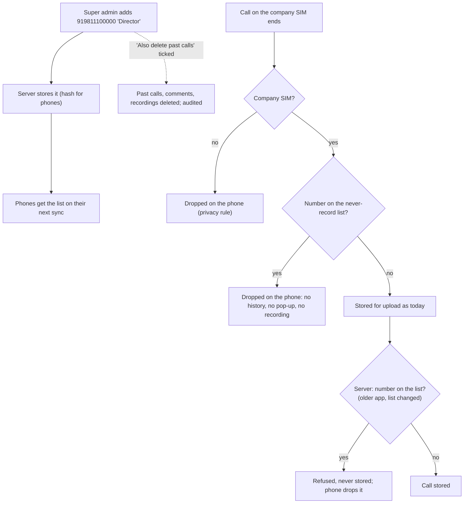

# M12. Numbers that are never recorded

- Status: **Design not started.** Asked by the client on 12 November 2026. The order the owner set: approve the design, write the spec, finish the design, then build.
- Owner: unassigned
- Starts after: none
- External prerequisites: none

## Outcome

The super admin keeps a list of phone numbers whose calls Callit must never record or keep: for example a company director, a doctor, or a family member who calls an employee's company SIM. A call to or from one of these numbers is dropped on the phone, like a personal-SIM call. It never appears in call history, reports, the dashboard or the CRM API, and its recording is never looked for or uploaded.

This is stronger than the **excluded numbers** that already exist: an excluded number's calls are stored and only left out of reports, while a never-record number's calls are not stored at all.

## Proposed design (to approve)

1. **Panel:** Settings → **Never record these numbers** (super admin). Add a number with a label, for example "Director" or "Office line"; remove one. Every change goes in the audit log.
2. **Phone:** the list comes with the app's settings on every sync (`GET /device/v1/config`). The app checks each call against the list **before** anything is stored for upload, in the same place it checks the company SIM. A matching call is skipped, the pop-up doesn't open, and its recording is never searched for. To keep the list private on the phone, the phone gets each number's SHA-256 hash, not the number itself.
3. **Server, as a second guard:** a phone can still send such a call: an older app version, or a call made before the phone's next sync picked up a new number. The server refuses those calls (the phone deletes them from its outbox) and never stores them. So a number is guaranteed out from the moment it's added on the server.
4. **Calls stored before the number was added:** when adding a number, the super admin can tick "Also delete past calls with this number". That deletes those calls, their comments and their recordings in R2, and audits it.

## Flow diagram

## Scope

In: the list per company in the panel, phones filtering with hashed numbers, the server refusing listed numbers, optional deletion of past calls and their recordings, tests proving a listed number's call is never stored (on the phone and on the server).

Out: number ranges or prefixes (for example all of a hospital's lines); employees adding numbers themselves.

## Data and API (outline)

- Migration `never_record_numbers`: `company_id`, `number`, `label`, `created_by`, `created_at`; primary key (`company_id`, `number`). If W2 below says "all companies", `company_id` is null for a ReapLift-wide entry.
- `GET /device/v1/config` adds `neverRecord: ["<sha256 of number>", ...]`.
- `POST /device/v1/calls` refuses listed numbers with reason `never record`.
- `GET, POST, DELETE /api/never-record-numbers` (super admin), with `deletePastCalls` on POST.

## Open questions (default in brackets)

- N1. Only the super admin (ReapLift), or each company's admin too? [Super admin only, as the client asked.]
- N2. One list per company, or one list for all companies, or both? [Per company, plus a ReapLift-wide list for numbers that should never be recorded anywhere.]
- N3. When a number is added, delete its past calls and recordings? [Offer the choice each time; not ticked by default.]
- N4. Should the employee see anything for such a call in the app? [No: it's as if the call wasn't on the company SIM.]

## Demo

1. The super admin adds a test number.
2. On a test phone, a company-SIM call with that number doesn't appear in the app, the panel, the dashboard or the CRM API, and no pop-up opens.
3. An older app version sending that call is refused by the server.
4. Removing the number makes new calls with it appear again.
5. With "Also delete past calls" ticked, the earlier calls and their recordings disappear, and the audit log shows who did it.
