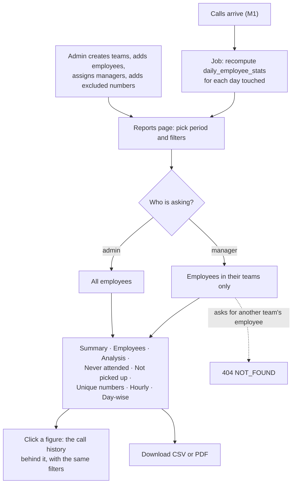

# M2. Call reports

- Status: In progress
- Owner: unassigned
- Starts after: M1
- External prerequisites: none

## Outcome

Admins and managers open Reports and see every report defined in the HLD's section 6 (summary, per employee, analysis, never attended, not picked up, unique numbers, hourly, day-wise) for any period up to 180 days, filtered by team, employee, call type, talk and ringing time. The numbers match a hand count of the same calls. Managers see only their own teams. Internal numbers can be excluded.

## Flow diagram

## Worked example

Teams: **North** (Ravi, Asha; manager `vikram@reaplift.com`) and **South** (Imran; manager `deepa@reaplift.com`). Excluded number: the office line `914040001000`.

Monday's company-SIM calls:

| Employee | Time | Number | Type | Ring | Talk | Meaning |
| --- | --- | --- | --- | --- | --- | --- |
| Ravi | 10:00 | 919900011111 | outgoing | 10 | 300 | connected |
| Ravi | 10:20 | 918800022222 | outgoing | 30 | 0 | voicemail or no answer |
| Ravi | 11:00 | 917700033333 | missed | 20 | 0 | missed inbound call |
| Ravi | 16:00 | 917700033333 | outgoing | 8 | 120 | connected follow-up |
| Ravi | 17:00 | 914040001000 | incoming | 5 | 60 | internal office line; excluded |
| Asha | 21:30 | 919900044444 | incoming | 6 | 240 | connected |
| Asha | 21:45 | 916600055555 | missed | 15 | 0 | missed outbound / no answer |
| Imran | 09:00 | 919900066666 | outgoing | 12 | 600 | connected |

Expected for Monday, team North, excluded numbers left out:

- Summary: 6 calls (Ravi 4, Asha 2; Ravi's 17:00 call to the office line is excluded); outgoing 3, incoming 1, missed 2; connected 3; talk 660 s; unique numbers 5. The 10:20 call to `918800022222` is counted as an attempt but not connected; it is included in the total attempt count and the outbound-no-answer bucket.
- Never attended: `916600055555` (Asha's missed call, never connected after). Not `917700033333`, because Ravi called back at 16:00 and talked.
- Not picked up: `918800022222`. This call is still an attempt even though talk time is 0 and it likely went to voicemail or no answer.
- Ravi's active time: 10:00 to 16:02:08 (16:00 + 8 s ring + 120 s talk) = 6 h 2 min 8 s. Idle time = active − (10+300+30+0+20+0+8+120 = 488 s).
- Asha's active time starts 21:30, showing calls outside office hours are counted (there are no working hours).
- Hourly: the 21:00 slot has 2 calls; 10:00 has 2; 11:00 has 1; 16:00 has 1.
- Vikram (North) sees Ravi and Asha; asking for Imran gives 404. Deepa sees only Imran.

The exact figures are written as a test fixture in task 2.6 and this example is corrected if the fixture disagrees.

## Scope

In: teams, team managers (`manager` users), excluded numbers, the eight reports with drill-down to call history, CSV and PDF export, the call filter's `teamIds` and `includeExcluded`, the `jobs` table and `MODE=worker`, `daily_employee_stats`.

Out: the daily email (M3), device health columns (M4), recording coverage (M6), CRM API (M5).

## Tasks

| Task | Name | Depends on | Parallel with |
| --- | --- | --- | --- |
| 2.1 | Teams, managers, excluded numbers, role scope | none | 2.2 |
| 2.2 | Jobs table, worker, daily stats | none | 2.1 |
| 2.3 | Report queries | 2.1, 2.2 | none |
| 2.4 | Reports page and drill-down | 2.3 | 2.5 |
| 2.5 | CSV and PDF export | 2.3 | 2.4 |
| 2.6 | Hand-count fixture test | 2.3 | 2.4, 2.5 |

### 2.1 Teams, managers, excluded numbers, role scope

- One scope function returns the employee IDs a user may see; every employee-data query uses it. A route-walking test calls every `/api` route as a manager with another team's employee and expects 404.

### 2.2 Jobs table, worker, daily stats

- Accepting a call batch queues a recompute for each (employee, India day) touched. Stats for a day are recomputed whole, so late-arriving calls fix the numbers.

### 2.3 Report queries

- Each report is one function over the call filter, using `daily_employee_stats` where the filter allows and `calls` where it does not (talk or ringing bounds, numbers). Results are the same either way; a test checks both paths.
- Acceptance: each report under 1 second for 100 employees × 180 days of test data (about 2.7 million calls).

### 2.4 Reports page and drill-down

- One page, a tab per report, filters at the top shared by all tabs. Every count links to the call history with matching filters.

### 2.5 CSV and PDF export

- Per report and for the history. PDF uses the same table as the page.

### 2.6 Hand-count fixture test

- The worked example's calls as a fixture; every report's output asserted exactly.

## Data and API

Migration 0003: `teams`, `team_members`, `team_managers`, `excluded_numbers`, `daily_employee_stats`, `jobs`; `users.role` gains `manager` in use. Routes in [data-model-and-api.md](../../data-model-and-api.md) under M2.

## Open questions

- Q3 (who manages whom) before the demo; teams can be set up with test data until then.
- Should a manager see employees who left? Default: yes, for calls before they left.

## Demo (milestone acceptance)

1. Load the worked example's calls through the device API (a test script posting as three paired test devices).
2. As admin, open each report for Monday, team North; every figure matches the worked example.
3. Include excluded numbers; Ravi's 17:00 call appears in the counts.
4. Log in as Vikram: only North; a URL with Imran's ID gives 404.
5. Click "never attended" and see the one call; download CSV and PDF.
