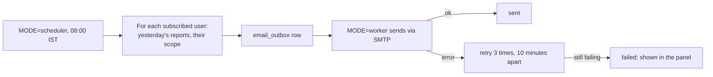

# M3. Daily email report

- Status: Not started
- Owner: unassigned
- Starts after: M2
- External prerequisites: E5 (email sender)

## Outcome

Every morning at 08:00 India time, each admin gets yesterday's report for everyone and each manager gets it for their own teams: totals, a row per employee, never-attended numbers, and employees with no calls. The email links to the same report in the panel. Failed sends are retried and visible.

## Flow diagram

## Worked example

On Tuesday at 08:00, Vikram gets "Calls for Monday 9 November, team North": 6 calls, 3 connected, 11 min talk; Ravi 4 calls, Asha 2; never attended: 916600055555 (Asha); no calls: none. Nikhila gets the same for all teams, plus Imran. The figures equal M2's worked example.

## Scope

In: SMTP sending through `email_outbox` (the same pattern as `reaplift-bsp` M2), the scheduler mode, the daily report email (HTML and plain text), per-user on/off, the delivery log page. A fake email provider in development and tests.

Out: alerts for phones that stopped syncing (M4), recording alerts (M6).

## Tasks

| Task | Name |
| --- | --- |
| 3.1 | Email outbox, SMTP provider, fake provider |
| 3.2 | Scheduler mode and the 08:00 job (runs once even if two schedulers start) |
| 3.3 | Report email content from M2's report functions |
| 3.4 | Subscriptions and delivery log page |

## Data and API

Migration: `email_outbox`, `report_subscriptions`. Settings: `SMTP_HOST`, `SMTP_PORT`, `SMTP_USER`, `SMTP_PASSWORD`, `EMAIL_FROM`, `DAILY_REPORT_TIME` (08:00).

## Open questions

- Q8: recipients and time. Default: admins and managers, 08:00.

## Demo (milestone acceptance)

1. With M2's fixture loaded, trigger the job for Tuesday 08:00.
2. Both emails arrive in real inboxes (E5) and match M2's figures.
3. Stop the SMTP server; the next send retries and shows as failed in the panel.
