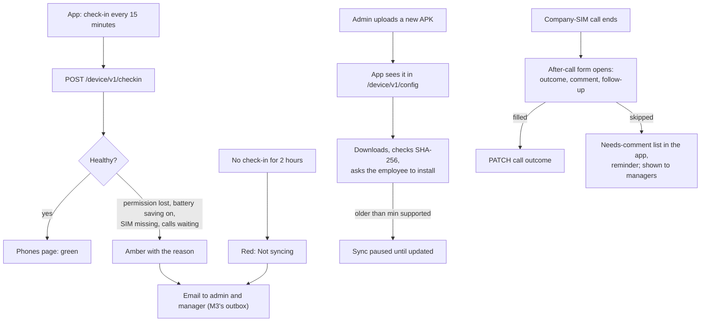

# M4. Phone health and app updates

- Status: Not started
- Owner: unassigned
- Starts after: M1
- External prerequisites: E1 (test phones)

## Outcome

The panel's Phones page shows, for every employee, whether their phone is healthy: last check-in, last sync, app version, battery saving, permissions, company SIM present, calls waiting to send, default dialer. A phone that goes quiet or loses a permission is flagged and the admin and manager are emailed. The app updates itself when a new APK is published, and right after each company-SIM call the employee fills a short after-call form: outcome, comment and optional follow-up date (owner, 11 November 2026). Calls left without a form stay on a "needs comment" list in the app with reminders, and managers see which calls have none.

## Flow diagram

## Worked example

Asha turns on her Oppo's battery saver at 13:00. Her 13:15 check-in reports it; the Phones page shows "Battery saving on" in amber and Vikram gets an email. Imran's phone is switched off overnight: at 02:00 it shows "Not syncing since 00:00" in red, and an email goes once, not every 15 minutes. Version 1.3 is published; Ravi's app downloads it and shows "Update ready"; he taps Install.

## Scope

In: check-ins, the Phones page and health rules, alert emails (deduplicated: one per problem until fixed), app releases and self-update (`REQUEST_INSTALL_PACKAGES`, SHA-256 check, minimum supported version), the after-call form (outcome, comment, follow-up date) with a needs-comment list and reminders, more brand guides, and the setup screen's device summary (brand, Android version, dialer) for the phone survey (E2).

Out: recording status (M6).

## Tasks

| Task | Name |
| --- | --- |
| 4.1 | Check-in endpoint, `device_checkins`, retention of 30 days |
| 4.2 | Health rules and the Phones page |
| 4.3 | Health alert emails, deduplicated |
| 4.4 | App releases: upload, `/device/v1/config` version, in-app update |
| 4.5 | After-call form: outcome, comment, follow-up; needs-comment list and reminders |
| 4.6 | Brand guides for any brand found in the phone survey |

## Data and API

Migration: `device_checkins`, `app_releases`, `devices.last_checkin_at`, `calls.note`, `calls.outcome` (company-defined list, `call_outcomes` table with `company_id`), `calls.follow_up_at`, `calls.commented_at`. Settings: `CHECKIN_SILENT_MINUTES` (120).

## Open questions

- Should a manager be able to revoke a phone, or admins only? Default: admins only.

## Demo (milestone acceptance)

On each test phone: turn on battery saving, revoke the call-log permission, remove the SIM, switch the phone off; each shows on the Phones page with the right reason and one email. Publish a new version; the phone updates without losing pairing. Finish a call; the after-call form opens; fill it and the outcome and comment show in call history. Skip one; it stays on the needs-comment list and the manager sees it.
