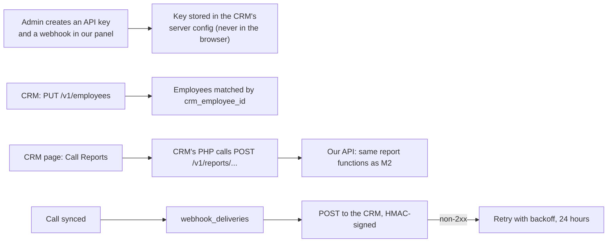

# M5. CRM integration

- Status: Not started
- Owner: unassigned
- Starts after: M2
- External prerequisites: E3 (the CRM's code, a test copy, a way to deploy to it)

## Outcome

ReapLift's CRM shows each employee's call history and the call reports, using our integration API with an API key, the way it would use Callyzer's. The CRM pushes its employees to us so admins do not type them twice, and receives a webhook for every synced company-SIM call. Personal-SIM calls never reach our server, so the CRM never sees them. Calls are linked to the CRM's leads where the number matches, for display only: a call with no matching lead is still kept and shown (D14).

This spec is finished after reading the CRM's code; the parts below are what does not depend on it.

## Flow diagram

## Worked example

The CRM sends Ravi as `{ crmEmployeeId: "E-1042", name: "Ravi Kumar", companyNumber: "919812345678", team: "North" }`; our existing Ravi is linked to `E-1042` because the number matches. Ravi's CRM customer list contains `919900011111` and a demo lead at `918800022222`, so only calls to those business numbers are kept for reporting. A call from `917000033333`, a client's friend who is not a lead, is kept and shown with no lead linked (D14). A call on Ravi's personal SIM never reaches our server. The CRM's Call Reports page calls `POST /v1/reports/employees` for last week and shows Ravi's row with the same figures as our panel. Ravi's next valid work call produces a `call.synced` webhook to the CRM within a minute.

## Scope

In: API keys (hashed, shown once), the `/v1` API listed in [data-model-and-api.md](../../data-model-and-api.md), rate limiting, webhooks with signing and retries, employee push from the CRM, an OpenAPI document generated from the Zod schemas, the CRM-side PHP pages (after E3), and linking calls to CRM leads by number for display (a left join: calls with no lead are kept).

Out: CRM changes unrelated to calls; leads (D1).

Only one filter applies: the phone drops any call not on the chosen company SIM. There is no lead or contact filter (D14, 11 November 2026); matching a call to a CRM lead is a left join for display, so calls from numbers that are not leads (for example a client's friend) are kept.

## Tasks

| Task | Name |
| --- | --- |
| 5.1 | API keys and the `/v1` authentication |
| 5.2 | `/v1` reports, call search and stream, using M2's functions |
| 5.3 | Employee push and matching |
| 5.4 | Webhooks: deliveries, signing, retries, delivery log |
| 5.5 | OpenAPI document and a PHP example client |
| 5.6 | CRM pages (designed after reading the CRM code) |

## Data and API

Migration: `api_keys`, `webhooks`, `webhook_deliveries`, `employees.crm_employee_id`. Settings: `WEBHOOK_SECRET_KEY` (encrypts stored secrets).

## Open questions

- Q6 (which CRM pages), Q7 (does the CRM store company numbers). Whether the CRM can make outgoing HTTPS calls from shared hosting: checked from the CRM's server in 5.6.

## Demo (milestone acceptance)

1. In the CRM's test copy, push employees; they appear linked in our panel.
2. The CRM's Call Reports page shows the same figures as our panel for the same period, for company-SIM calls, including calls from numbers that are not CRM leads; a personal-SIM call is absent from both.
3. A company-SIM call on a test phone produces a webhook the CRM records; stopping the CRM's endpoint makes deliveries retry and then succeed when it returns.
