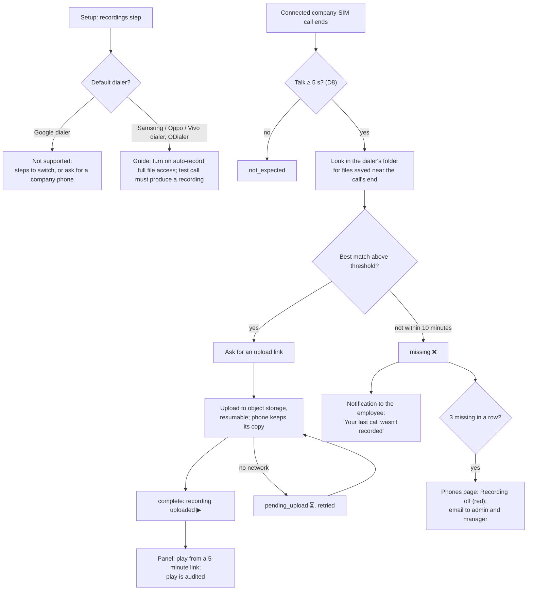

# M6. Call recordings

- Status: Not started
- Owner: unassigned
- Starts after: M4
- External prerequisites: E1 (test phones), E2 (phone survey), E6 (object storage)

## Outcome

Every connected company-SIM call has its recording in the panel, playable by admins and the employee's managers. The phone's own dialer records the call; our app finds the file, matches it to the call, and uploads it to object storage. Recording is compulsory (owner, 7 November 2026): a connected call with no recording is marked missing, the employee is told straight away, and a phone with recordings off shows red on the Phones page. Recordings that do not match a company-SIM call are never uploaded.

## Flow diagram

## Worked example

Ravi's Vivo saves recordings to the folder found in T4, named with the number and time. His 14:02 call (talk 3 min 05 s) ends at 14:05:17; a file saved at 14:05:19 with an audio length of 3 min 06 s and "9900011111" in its name scores high and is uploaded; the panel shows ▶. His 14:10 call had 0 talk: no recording expected. At 18:00 he turns off auto-record; his 18:05 and 18:20 calls get no file, each is marked missing and he gets a notification after each; after the third, at 18:40, the Phones page shows "Recording off since 18:05" and Vikram is emailed. His 14:40 personal-SIM call was recorded by the dialer too, but no company-SIM call matches it, so the app never opens or uploads it.

## Scope

In: the recordings setup step and dialer check, `MANAGE_EXTERNAL_STORAGE`, per-brand folder and file-name rules (from T4), matching, upload links and resumable upload, MinIO in `compose.dev.yml`, recording status per call (▶ ⏳ ❌ —), the missing-recording notification and Phones page status, coverage (recorded ÷ expected) on the Reports page and in the daily email, the player with audited plays, retention by a storage lifecycle rule (D4), the `/v1` recording link and the two webhook events.

Out: recording through a calling provider; transcription.

## Tasks

| Task | Name |
| --- | --- |
| 6.1 | Test-phone research: answer T4 to T6 for Samsung, Oppo (own dialer and ODialer), Vivo, and the Google dialer |
| 6.2 | Object storage: MinIO locally, R2 or S3 settings (D6), private bucket, lifecycle rule |
| 6.3 | Server: upload link, complete, missing; `recordings` table; play link |
| 6.4 | App: folder access, matching, upload queue |
| 6.5 | App: setup step, dialer check, test call with recording, missing notification |
| 6.6 | Panel: status icons, player, filters, coverage, Phones page status, emails |
| 6.7 | Privacy test: a recording of a personal-SIM call is never uploaded |

## Data and API

Migration: `recordings`, `recording_plays`. Settings: `S3_ENDPOINT`, `S3_REGION`, `S3_BUCKET`, `S3_ACCESS_KEY_ID`, `S3_SECRET_ACCESS_KEY`, `RECORDING_MIN_TALK_SECONDS` (5), `RECORDING_MATCH_MINUTES` (10), `RECORDING_RETENTION_DAYS` (365).

## Open questions

- D2 (all company-SIM calls or CRM numbers only), D4 (retention), D6 (provider), D8 (short calls), D9 (mobile data).
- Q5 (do customers need to be told).

## Demo (milestone acceptance)

On each supported test phone: make the worked example's calls; recordings play in the panel for the right calls only; turn off auto-record and see missing, the notification, and "Recording off"; turn it back on and see it recover; prove by listing the bucket that no personal-SIM recording was uploaded. On a Google-dialer phone, setup shows "not supported" with the steps.
