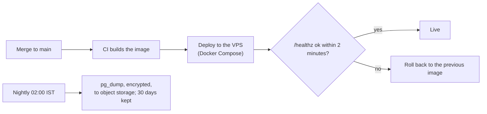

# M7. Deploy

- Status: Not started
- Owner: unassigned
- Starts after: M0
- External prerequisites: E4 (Hostinger VPS and a domain), E6 (object storage for backups)

## Outcome

A merge to `main` deploys the server, worker, scheduler and panel to a Hostinger VPS at an HTTPS address (for example `calls.reaplift.com`) that the phones and the CRM use. A failed health check rolls back. PostgreSQL is backed up every night to object storage, and a restore has been tested.

## Flow diagram

## Scope

In: production Docker image and compose file (api, worker, scheduler, PostgreSQL, Caddy for HTTPS), deploy from CI over SSH, rollback, backups and a restore drill, server firewall (only 80 and 443 open, SSH by key), log rotation, uptime check, the APK served from the VPS.

Out: more than one server; the CRM's hosting.

## Tasks

| Task | Name |
| --- | --- |
| 7.1 | Production image and compose, run locally |
| 7.2 | VPS setup: user, firewall, Docker, Caddy, domain |
| 7.3 | Deploy and rollback from CI |
| 7.4 | Backups and a restore drill |
| 7.5 | Uptime check and alert email |

## Data and API

No new tables. Settings: `BACKUP_S3_*`, `BACKUP_ENCRYPTION_KEY`, `DEPLOY_HOST`, `DEPLOY_SSH_KEY` (CI secret).

## Open questions

- VPS size: start with 2 vCPU and 8 GB for 100 employees; check prices when buying (E4).

## Demo (milestone acceptance)

Merge a change; it is live over HTTPS; a test phone syncs to it over mobile data. Deploy a build with a broken `/healthz`; it rolls back. Restore last night's backup to a fresh database and count the calls.
