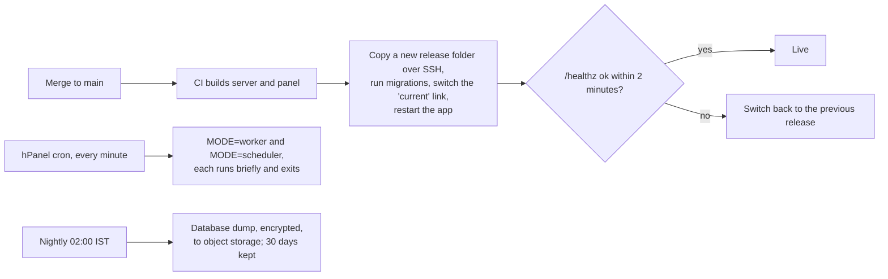

# M7. Deploy

- Status: Not started
- Owner: unassigned
- Starts after: M0, P1
- External prerequisites: E4 (`callit.reaplift.com` created; Node.js web app and MariaDB database on the existing Hostinger shared plan), E6 (object storage for backups)
- Reshaped on 11 November 2026 by decision D10: Hostinger shared hosting and MariaDB instead of a VPS with Docker and PostgreSQL. P1.6 checks the path first.

## Outcome

A merge to `main` deploys the server and panel to `https://callit.reaplift.com`, a Node.js web app on ReapLift's existing Hostinger shared plan, which the phones and the CRM use. hPanel cron runs the worker and scheduler. A failed health check rolls back. The MariaDB database is backed up every night to object storage, and a restore has been tested.

## Flow diagram

## Scope

In:
- Building for Passenger: the server listens on the port Passenger gives it, and the startup file is set in hPanel.
- Release folders with a `current` link (as `billit.reaplift.com` does with `hbuilds/current`).
- Deploy from CI over SSH with a deploy key held as a GitHub Actions secret; migrations; rollback.
- hPanel cron for the worker and scheduler.
- The panel's static build served by the server.
- The APK served from `callit.reaplift.com`.
- `.env` kept outside the web root.
- Backups and a restore drill; an uptime check.

Out:
- Any host other than Hostinger (owner, 11 November 2026). If the service outgrows the current plan, ReapLift upgrades within Hostinger.
- The CRM's hosting.

## Tasks

| Task | Name |
| --- | --- |
| 7.1 | Production build for Passenger, run locally |
| 7.2 | hPanel setup: Node.js web app, MariaDB database and user, cron, Cloudflare DNS and HTTPS |
| 7.3 | Deploy and rollback from CI |
| 7.4 | Backups and a restore drill |
| 7.5 | Uptime check and alert email |

## Data and API

No new tables. Settings: `BACKUP_S3_*`, `BACKUP_ENCRYPTION_KEY`, `DEPLOY_HOST`, `DEPLOY_SSH_KEY` (CI secret).

## Open questions

- How long the first request takes after the app has been idle, and whether the phones' retries cover it (measured in P1.6).
- Whether hPanel cron allows every-minute jobs (checked in P1.6).
- When to upgrade the Hostinger plan: if memory, processes or disk hit the current plan's limits.

## Demo (milestone acceptance)

Merge a change; it is live over HTTPS; a test phone syncs to it over mobile data. Deploy a build with a broken `/healthz`; it rolls back. Restore last night's backup to a fresh database and count the calls.
