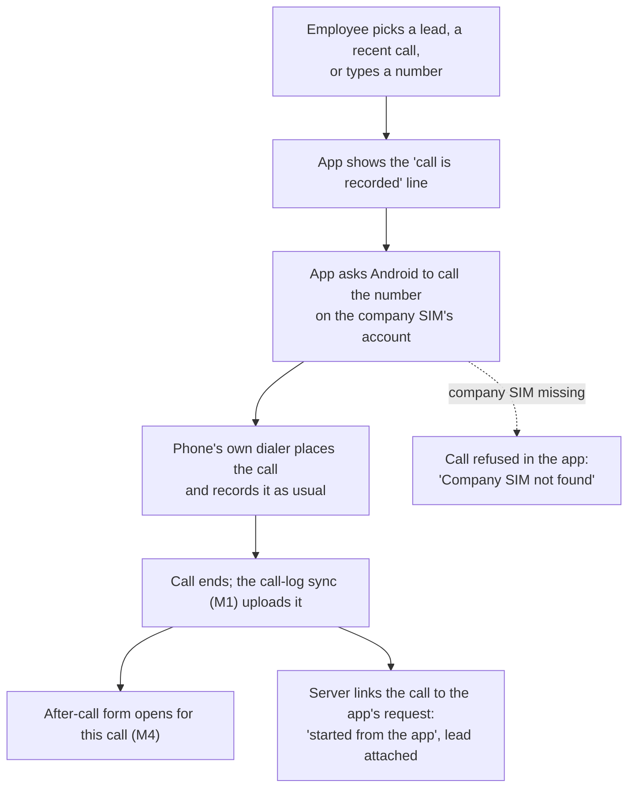

# M9. Call from the app

- Status: Not started (outline; finished before work starts)
- Owner: unassigned
- Starts after: M4 (after-call form), M5 (numbers from the CRM)
- External prerequisites: E1 (test phones)
- Decided: owner, 11 November 2026 (tracker decision log, M9)

## Outcome

The employee opens our app, picks a number to call (a lead from the CRM, a recent call, or one typed in) and taps Call. The app shows the line to say at the start ("This call is recorded and monitored for quality", D13), then hands the call to the phone's own dialer on the company SIM. The dialer places and records the call as usual. When the call ends, the after-call form (M4) opens for that call, and the call in the panel is marked "started from the app" and linked to the lead.

## Flow diagram

## Scope

In:
- A **Call** screen in the app: CRM leads assigned to the employee (from M5), recent company-SIM calls, and a keypad.
- Placing the call through Android on the company SIM's calling account, so the phone's dialer handles and records it.
- The D13 line shown before dialling.
- The after-call form opened straight after.
- The server matching the call to the app's request by number and time, and marking it.

Out:
- Our app becoming the phone's default dialer. On most phones that stops the brand's own call recording, because Android does not let ordinary apps record call audio. To confirm on the test phones.
- Calling from the CRM's web page to the phone (later, if wanted).
- An automatic recorded announcement to the customer (the supported dialers cannot do it).

## Data and API (outline)

- `call_requests`: `id`, `company_id`, `employee_id`, `device_id`, `number`, `crm_lead_id null`, `requested_at`, `call_id null` (filled when the synced call matches).
- `calls.started_from_app` (bool) and `calls.crm_lead_id null`.
- `POST /device/v1/call-requests` before dialling; `GET /device/v1/leads` (from M5).
- Permission `CALL_PHONE`, added in this milestone.

## Open questions

- Which leads does an employee see: only leads assigned to them in the CRM? Default: yes.
- Does each brand's dialer still auto-record a call started by another app? Checked on each test phone (T4).

## Demo (milestone acceptance)

On each test phone: pick a lead in the app and tap Call. The line to say shows; the phone's dialer calls on the company SIM and records. After hanging up, the after-call form opens. In the panel the call shows "started from the app" with the lead and the recording. A personal-SIM call made from the phone's dialer is still never uploaded.
