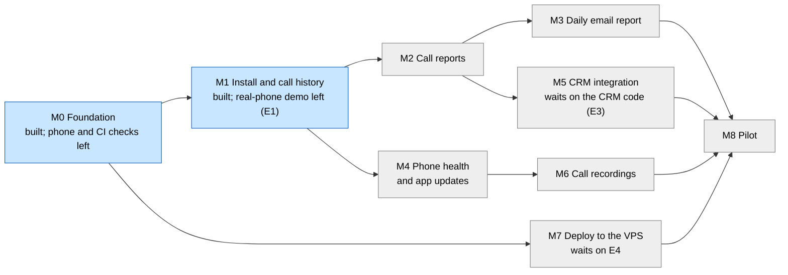

# Project tracker

This is the one place for overall status, the order of work, the rules everyone follows, and the decisions the owner has made. Each milestone's full detail (flow diagram, worked example, tasks, tests, data, open questions) lives in its own spec under [docs/milestones/](milestones/README.md). Every table and route, existing and planned, is listed in [data-model-and-api.md](data-model-and-api.md). The why behind the design is in [requirements-and-hld.md](requirements-and-hld.md). Read this file first, then the spec for the milestone you are working on.

Last updated: 7 November 2026.

## How the plan is organised

- **One milestone = one flow.** A milestone is a flow a person can run and watch work from start to finish, for example "an employee installs the app and their calls appear in the panel". When that flow passes its demo, the milestone is Done. Nothing else makes it Done.
- **One spec per milestone**, short enough to review in one sitting.
- **Tasks live inside a spec.** People work in parallel by taking different tasks inside one milestone, or milestones with no arrow between them below.

## Roadmap

Arrows mean "must be Done before the next one starts". Recordings come last on the owner's instruction (7 November 2026).

Next in order: M2 (call reports), while waiting for test phones (E1) to finish M0 and M1. M7 can be built alongside M1 to M6 once the VPS exists (E4).

## Status board

Update your row in the same commit that changes a task's status.

| Milestone | Flow it delivers | Status | Owner | Starts after | External prerequisites |
| --- | --- | --- | --- | --- | --- |
| [M0](milestones/m0-foundation/spec.md) Foundation | A developer clones the repo, runs the server, panel and an Android debug build locally; CI checks every push | Built on 7 November 2026 ([test-evidence.md](milestones/m0-foundation/test-evidence.md)); Done after the APK reaches the server from a real phone and CI runs on GitHub | unassigned | none | none |
| [M1](milestones/m1-install-and-call-history/spec.md) Install and call history | Admin adds an employee; the employee installs the APK from a QR code and pairs it; their company-SIM calls appear in the panel's call history | Built on 8 November 2026; run end to end on the Android 15 emulator ([test-evidence.md](milestones/m1-install-and-call-history/test-evidence.md)). Done after the real-phone demo (E1) and release signing | unassigned | M0 | E1 (test phones) |
| [M2](milestones/m2-call-reports/spec.md) Call reports | Admin and managers see every report in the HLD's section 6, with filters, and the numbers match a hand count | In progress (manager access and report summary foundation added) | unassigned | M1 | none |
| [M3](milestones/m3-daily-email/spec.md) Daily email report | Every morning admins and managers get yesterday's report by email | Not started | unassigned | M2 | E5 (email sender) |
| [M4](milestones/m4-phone-health-and-updates/spec.md) Phone health and updates | The panel shows which phones are healthy, silent or misconfigured; the app updates itself; the employee can add a note after a call | Not started | unassigned | M1 | E1 |
| [M5](milestones/m5-crm-integration/spec.md) CRM integration | The CRM shows call history and reports for its employees through our API, and receives a webhook per call | Not started | unassigned | M2 | E3 (CRM code and access) |
| [M6](milestones/m6-call-recordings/spec.md) Call recordings | A company-SIM call's recording is uploaded and played in the panel; a missing recording is flagged and the employee is told | Not started | unassigned | M4 | E1, E2 (phone survey), E6 (storage) |
| [M7](milestones/m7-deploy/spec.md) Deploy | A push to `main` deploys to the Hostinger VPS with HTTPS, a health check, rollback and tested backups | Not started | unassigned | M0 | E4 (VPS, domain), E6 |
| [M8](milestones/m8-pilot/spec.md) Pilot | Five employees, then everyone, use it for two weeks with no gaps a manager notices | Not started | ReapLift | M3, M5, M6, M7 | E1 to E6 |

## Dependency rule

**A milestone starts only when every milestone in its "Starts after" column is Done.** An external prerequisite is something outside the code; a milestone can be built without it but is not Done until its demo, which needs it, passes. If a Done milestone turns out broken, it goes back to In progress.

### External prerequisites

| ID | Prerequisite | Who | Needed by | State |
| --- | --- | --- | --- | --- |
| E1 | Test phones: at least one Samsung, one Oppo and one Vivo, each with a SIM, on Android 10 or newer, and a second SIM to prove personal calls are never uploaded | ReapLift | M1 demo, M4, M6 | Not started |
| E2 | Phone survey of all employees: brand, model, Android version, default dialer, whether auto-record exists. Employees can send a screenshot of the app's setup screen (M1 shows brand, Android version and dialer) | ReapLift | M6, and the company-phone purchase | Not started (owner, 7 November 2026) |
| E3 | The CRM's code, a test copy of it, and a way to deploy pages to it | ReapLift | M5 | Owner to share |
| E4 | A Hostinger VPS and a domain or subdomain for the server, for example `calls.reaplift.com` | ReapLift | M7 | Not started |
| E5 | An email sender for reports, for example Hostinger SMTP for `reaplift.com` | ReapLift | M3 demo | Not started |
| E6 | An object-storage account (Cloudflare R2 or AWS S3 Mumbai) for recordings and backups | ReapLift | M6 demo, M7 backups | Not started |

## Decisions that need the owner

Each has a default, so work does not stop; the default is built unless the owner says otherwise.

| ID | Question | Default if nobody decides | Blocks |
| --- | --- | --- | --- |
| D1 | Leads: earlier "skip lead management", later "build all Callyzer features". In or out? | Out | nothing in M0 to M8 |
| D2 | Recordings to upload: all company-SIM calls, or only calls with numbers in the CRM? | All company-SIM calls | M6 |
| D3 | How many days of past calls to sync when a phone is paired | 7 days | M1 task 1.5 |
| D4 | Retention: how long recordings and call rows are kept | Recordings 12 months; call rows indefinitely | M6, M7 |
| D5 | Our own admin panel as well as the CRM pages? | Yes: our panel for admins and managers from M1; the CRM gets the same data through the API in M5 | M1 |
| D6 | Object storage: Cloudflare R2 or AWS S3 Mumbai | R2 (no download fees, which suits playing recordings) | M6, M7 |
| D7 | Lowest Android version supported | Android 10 | M0, M1 |
| D8 | Shortest call that must have a recording, below which a missing one is not flagged | 5 seconds | M6 |
| D9 | Recordings over mobile data, or Wi-Fi only? | Any network | M6 |

## Decision log

### 8 November 2026

- **M1 built** and run end to end on an Android 15 emulator: QR install page, six-step setup, company-SIM sync with ringing time, offline and reboot recovery, unpairing. Real phones (E1) are next.
- **Install flow:** the install page's "Open the app" link fills in the pairing code; typing it is the fallback (replaces reading the code from the APK file name).
- **The phone's outbox is plain SQLite**, not Room, to avoid an extra code generator this week.
- **Android's permission prompt for phone state reads "make and manage phone calls"**, which may worry employees; the app's explanation before it says what it is for. Worth a line in the consent text (Q4).

### 7 November 2026

- **Build our own Callyzer-style product** for ReapLift's own employees only, focused on detailed call history and call reports. Lead management is not in scope (D1 asks to confirm). Not sold to other companies, so one company, no billing, no `client_id`.
- **Android only, installed as an APK**, not from the Play Store. Play's call-log permission needs a declaration and review, which an APK avoids; it also allows full file access for recordings.
- **Company SIMs in employees' personal phones.** Only company-SIM calls ever leave the phone, filtered on the phone (CLAUDE.md's privacy rule).
- **Recordings are compulsory** for employees and in the first version, as the **last** milestone (M6). The phone's dialer records; the app uploads. A connected call with no recording is flagged and the employee is told.
- **The Google dialer is not supported for recordings** (its files are not readable by other apps, per telecrm and Salestrail; to confirm on a real phone). Employees on it switch dialer where possible; otherwise ReapLift gives them a company phone. Most employees are on Oppo, Vivo and Samsung.
- **No working hours**: marketing calls are made at any time. "Working hours" in reports is active time, from an employee's first call to their last each day; hourly reports cover all 24 hours. HLD section 6.
- **New repository `reaplift-call-tracker`**, separate from `reaplift-bsp`, on the same stack.
- **Hosting**: the CRM is PHP and MySQL on Hostinger shared hosting, so our service runs on its own Hostinger VPS (M7); recordings in object storage (D6). The CRM calls our API (M5).
- **Size**: 50 employees today, up to 100.

## Rules for every milestone

### Definition of Done

A task is Done only when all of these are true. A milestone is Done when all its tasks are Done and its demo has been run end to end and recorded in its evidence pack.

1. A user can run the flow in the real panel or the real app on a real phone and see the expected result.
2. The panel and the app call the real server and get real responses; nothing comes from mock data or in-memory lists.
3. The server validates input and rejects bad requests with the documented error code.
4. State is saved in PostgreSQL (and, for the app, in its local database) and survives a restart of the server and of the phone.
5. Role rules are enforced by the server, and a test proves a manager cannot read another team's data.
6. The privacy rule holds: a test, and the demo on a dual-SIM phone, prove no personal-SIM call is uploaded.
7. The tests listed in the spec exist and pass in CI.
8. This tracker's status board matches what the code really does.

If any check fails, the task is In progress or Prototype, never Done.

### Do

- Read this tracker and your milestone's spec before starting.
- Write the route, request and response, and error codes in the spec before coding them.
- Record the phone model and Android version in the evidence for anything tested on a phone.
- Update the spec and the status board in the same commit as the code that changes them.

### Do not

- Do not call a task done because a page renders or an emulator showed it.
- Do not start a milestone before every milestone in its "Starts after" column is Done.
- Do not trust Android behaviour from memory or from one brand; check on the test phones.

### Repo rules

From [CLAUDE.md](../CLAUDE.md). Branches follow `reaplift-bsp`'s two-branch model ([team-workflow.md](team-workflow.md)).

### Evidence pack

Each milestone folder holds its `spec.md` plus, by the time it is Done: `test-evidence.md` (exact commands, SQL and real output), `frontend.md` (panel pages), `android.md` (app screens, phone models tested), `e2e.md` (the demo run). See [milestones/README.md](milestones/README.md).

## Migration number registry

Claim a number before writing the file.

| Number | File | Milestone and task | State |
| --- | --- | --- | --- |
| 0001 | `0001_init.sql` | M0 | Written (uncommitted) |
| 0002 | `0002_employees_devices_calls.sql` | M1 | Written (uncommitted) |
| 0003 | next free | | Free |
