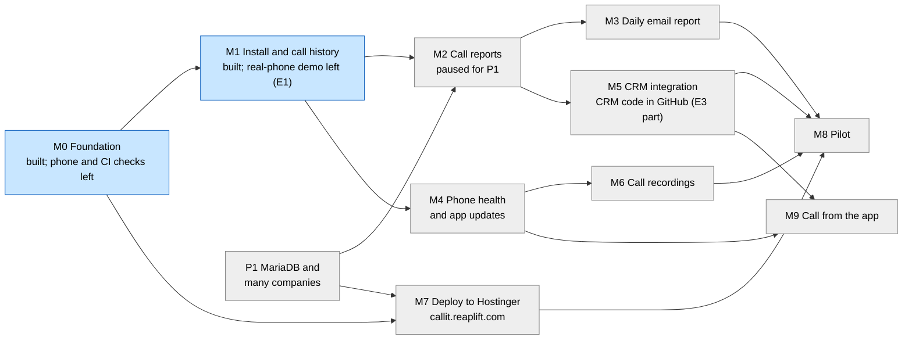

# Project tracker

This is the one place for overall status, the order of work, the rules everyone follows, and the decisions the owner has made. Each milestone's full detail (flow diagram, worked example, tasks, tests, data, open questions) lives in its own spec under [docs/milestones/](milestones/README.md). Every table and route, existing and planned, is listed in [data-model-and-api.md](data-model-and-api.md). The why behind the design is in [requirements-and-hld.md](requirements-and-hld.md). Read this file first, then the spec for the milestone you are working on.

Last updated: 11 November 2026.

## How the plan is organised

- **One milestone = one flow.** A milestone is a flow a person can run and watch work from start to finish, for example "an employee installs the app and their calls appear in the panel". When that flow passes its demo, the milestone is Done. Nothing else makes it Done.
- **One spec per milestone**, short enough to review in one sitting.
- **Tasks live inside a spec.** People work in parallel by taking different tasks inside one milestone, or milestones with no arrow between them below.

## Roadmap

Arrows mean "must be Done before the next one starts". Recordings come last on the owner's instruction (7 November 2026).

The core tracker is the working call-history + reports flow. The product extension layer is the Callyzer-style operational and business features: phone health, recording coverage, daily summaries and CRM/API integration. These are included in the roadmap and kept in the design even though they are not required for the first demo.

Next in order: P1 (move to MariaDB and serve many companies, decisions D10 and D11), then M2 continues on MariaDB, while waiting for test phones (E1) to finish M0 and M1. P1 is a platform change, not a flow; it is done first because every new M2 query written for PostgreSQL would have to be moved too. M7 can be built alongside M2 to M6 once P1 is done.

## Status board

Update your row in the same commit that changes a task's status.

| Milestone | Flow it delivers | Status | Owner | Starts after | External prerequisites |
| --- | --- | --- | --- | --- | --- |
| [M0](milestones/m0-foundation/spec.md) Foundation | A developer clones the repo, runs the server, panel and an Android debug build locally; CI checks every push | Built on 7 November 2026 ([test-evidence.md](milestones/m0-foundation/test-evidence.md)); Done after the APK reaches the server from a real phone and CI runs on GitHub | unassigned | none | none |
| [M1](milestones/m1-install-and-call-history/spec.md) Install and call history | Admin adds an employee; the employee installs the APK from a QR code and pairs it; their company-SIM calls appear in the panel's call history | Built on 8 November 2026; run end to end on the Android 15 emulator ([test-evidence.md](milestones/m1-install-and-call-history/test-evidence.md)). Done after the real-phone demo (E1) and release signing | unassigned | M0 | E1 (test phones) |
| [P1](milestones/p1-mariadb-and-companies/spec.md) MariaDB and many companies | The server runs on MariaDB (Hostinger shared hosting); every company's data is kept apart by `company_id`; a super admin manages companies | In progress. Built 11 November 2026: P1.1 to P1.5 (MariaDB, companies, scope, 18 isolation tests) and P1.6 (live at `https://callit.reaplift.com`). Left: panel company picker and Companies page, P1.7 evidence. P1.8 legal sign-off feature deferred: the owner handles legal sign-off before the end-to-end demo | unassigned | none | none |
| [M2](milestones/m2-call-reports/spec.md) Call reports | Admin and managers see every report in the HLD's section 6, with filters, and the numbers match a hand count | In progress. Task 2.7 dashboard built and live 12 November 2026 (four cards, first page after login, 6 integration tests; same numbers as the CRM API). Rest of M2 not started | unassigned | M1, P1 | none |
| [M3](milestones/m3-daily-email/spec.md) Daily email report | Every morning admins and managers get yesterday's report by email | Not started | unassigned | M2 | E5 (email sender) |
| [M4](milestones/m4-phone-health-and-updates/spec.md) Phone health and updates | The panel shows which phones are healthy, silent or misconfigured; the app updates itself; the employee fills an after-call form | Task 4.5 (after-call form) built 11 November 2026, ahead of the rest on the owner's instruction, and run on the Android 15 emulator ([test-evidence.md](milestones/m4-phone-health-and-updates/test-evidence.md)); app 0.3.0 published for the Country Roads beta. Tasks 4.1 to 4.4 and 4.6 not started | unassigned | M1 | E1 |
| [M5](milestones/m5-crm-integration/spec.md) CRM integration | The CRM shows call history and reports for its employees through our API, and receives a webhook per call | In progress. 12 November 2026: tasks 5.1 and 5.2 built as a Callyzer v2.3-compatible API at `/api/v2.3/` with per-company API keys, made in the panel's Settings ([callyzer-compatibility.md](milestones/m5-crm-integration/callyzer-compatibility.md)); 21 integration tests. Left: webhooks (5.4), employee push (5.3), CRM lead and task link (waits on the client's answers) | unassigned | M2 | E3 (CRM code and access) |
| [M6](milestones/m6-call-recordings/spec.md) Call recordings | A company-SIM call's recording is uploaded and played in the panel; a missing recording is flagged and the employee is told | Built 11 November 2026 on the owner's instruction (ahead of M4) and run end to end on the Android 15 emulator with S3-compatible local storage ([test-evidence.md](milestones/m6-call-recordings/test-evidence.md)); app 0.4.0 published. Live recording on Hostinger waits on the R2 keys (E6); real-phone dialer folders to confirm in the Country Roads beta (E1, T4) | unassigned | M4 | E1, E2 (phone survey), E6 (storage) |
| [M7](milestones/m7-deploy/spec.md) Deploy | A push to `main` deploys to `callit.reaplift.com` (Hostinger shared hosting, Node.js web app) with HTTPS, a health check, rollback and tested backups | Not started | unassigned | M0, P1 | E4 (domain done; MariaDB database), E6 |
| [M8](milestones/m8-pilot/spec.md) Pilot | Five employees, then everyone, use it for two weeks with no gaps a manager notices | Not started | ReapLift | M3, M5, M6, M7 | E1 to E7 (E7: legal sign-off) |
| [M9](milestones/m9-call-from-app/spec.md) Call from the app | The employee taps a number in the app (a CRM lead or a typed number); the phone's dialer calls it on the company SIM; the "call is recorded" line shows first; the after-call form opens after | Not started | unassigned | M4, M5 | E1 |
| [M10](milestones/m10-whatsapp-templates/spec.md) WhatsApp message templates | The admin writes fixed WhatsApp templates; after a call the employee picks one, the client's name is filled in (or typed), reviews it and WhatsApp opens with the text; the panel logs the send | Design written 12 November 2026, waiting for the owner's approval; questions W1 to W6 in the spec. Not started | unassigned | M4 task 4.5 | E1 |

### Product extension set we keep in scope

The tracker is intentionally broader than the first smoke-test flow. The following operational and business features are part of the long-term product and are explicitly kept in the design so they can be added later without redesigning the core system:

- Phone health: silent phones, battery/autostart issues, offline checks, app-status warnings, and per-device health pages.
- Recording coverage: matched call-to-recording status, missing-recording flags, and the recording player with audit events.
- Daily report email: manager and admin summaries by day, including connect rate and missed/no-answer counts.
- CRM/API integration: webhook delivery, report endpoints, and the CRM-facing call history pages that mirror the panel.
- Drill-down views: per employee, per number, and per report detail pages to support deeper call review.
- After-call form: outcome, comment and follow-up date right after each call, with a needs-comment list (M4, owner, 11 November 2026).
- Later extension, not in the current plan: AI call summary in the dashboard, after M6 (owner, 11 November 2026; HLD section 5).

These features are part of the product roadmap, but they are not required to prove the first working call-tracker flow on a real phone.

## Dependency rule

**A milestone starts only when every milestone in its "Starts after" column is Done.** An external prerequisite is something outside the code; a milestone can be built without it but is not Done until its demo, which needs it, passes. If a Done milestone turns out broken, it goes back to In progress.

### External prerequisites

| ID | Prerequisite | Who | Needed by | State |
| --- | --- | --- | --- | --- |
| E1 | Test phones: at least one Samsung, one Oppo and one Vivo, each with a SIM, on Android 10 or newer, and a second SIM to prove personal calls are never uploaded | ReapLift | M1 demo, M4, M6 | Not started |
| E2 | Phone survey of all employees: brand, model, Android version, default dialer, whether auto-record exists. Employees can send a screenshot of the app's setup screen (M1 shows brand, Android version and dialer) | ReapLift | M6, and the company-phone purchase | Not started (owner, 7 November 2026) |
| E3 | The CRM's code, a test copy of it, and a way to deploy pages to it | ReapLift | M5 | Partly met (11 November 2026): live code from Hostinger is in GitHub `reaplift/crm-laravel`, branch `sync-from-hostinger` (PR #1). Test copy and a deploy route still needed |
| E4 | A domain for the server and a MariaDB database on the existing Hostinger shared plan (D10; no VPS) | ReapLift | M7 | Partly met (11 November 2026): `callit.reaplift.com` created; DNS is on Cloudflare. Node.js web app and database still to set up (P1.6) |
| E5 | An email sender for reports, for example Hostinger SMTP for `reaplift.com` | ReapLift | M3 demo | Not started |
| E7 | Legal sign-off before real employees' data is collected: the consent text, an employee policy, and for client companies (D11) the agreement on who is responsible for the data under the DPDP Act 2023 (Q4, Q9). Installing by APK does not remove this. Test phones used by ReapLift staff who agree in writing do not need it | ReapLift (HR or legal) | M8 pilot, and any use with real employees before it | Not started |
| E6 | An object-storage account (Cloudflare R2 or AWS S3 Mumbai) for recordings and backups | ReapLift | M6 demo, M7 backups | Partly met: ReapLift has a Cloudflare account (R2 bucket to create at M6) |

## Decisions that need the owner

Each has a default, so work does not stop; the default is built unless the owner says otherwise.

| ID | Question | Default if nobody decides | Blocks |
| --- | --- | --- | --- |
| D1 | Leads: earlier "skip lead management", later "build all Callyzer features". In or out? | Out | nothing in M0 to M8 |
| D2 | Recordings to upload: all company-SIM calls, or only calls with numbers in the CRM? | All company-SIM calls | M6 |
| D3 | How many days of past calls to sync when a phone is paired | 7 days | M1 task 1.5 |
| D4 | Retention: how long recordings and call rows are kept | **Decided (owner, 11 November 2026): recordings 12 months**, deleted by an R2 lifecycle rule (365 days after upload); call rows indefinitely, pending legal (Q12) | M6, M7 |
| D5 | Our own admin panel as well as the CRM pages? | Yes: our panel for admins and managers from M1; the CRM gets the same data through the API in M5 | M1 |
| D6 | Object storage: Cloudflare R2 or AWS S3 Mumbai | **Decided: Cloudflare R2** on ReapLift's existing account (owner, 11 November 2026) | M6, M7 |
| D7 | Lowest Android version supported | Android 10 | M0, M1 |
| D8 | Shortest call that must have a recording, below which a missing one is not flagged | 5 seconds | M6 |
| D9 | Recordings over mobile data, or Wi-Fi only? | Any network | M6 |

## Decision log

### 11 November 2026

- **D10, hosting and database (owner):** the service runs on ReapLift's **existing Hostinger shared hosting plan** as a Node.js web app at `callit.reaplift.com`, the way `billit.reaplift.com` already runs, with a **MariaDB** database on the same plan. This replaces "own Hostinger VPS with PostgreSQL" (7 November). Why: no extra cost; one kind of database with the CRM (MySQL) and the team already knows it; data stays on Hostinger in India. Checked over SSH: Node 22 is available, MariaDB is 11.8, apps are started on request and stopped when idle, and outbound connections work. Consequences: the worker and scheduler run from hPanel cron instead of always running. **No other hosting provider and no PostgreSQL (owner, 11 November 2026):** the budget is the current Hostinger plan; if the database or load grows, ReapLift upgrades within Hostinger (a bigger plan or more storage). Recording audio (M6) is the one exception: it is about 1.5 TB a year, more than the plan's 200 GB, so it is stored in **Cloudflare R2** on the account ReapLift already has (owner, 11 November 2026; settles D6). Our database is **separate** from the CRM's (`u436365342_reapLiftCrm`); the CRM reads our data only through the API (M5).
- **D11, many companies (owner):** the tracker serves ReapLift's client companies (for example BSNL and Country Roads), the same companies the CRM serves with its `company_id`. Each company's own employees install the app. Every company-data table carries `company_id`, using the CRM's number for the company; a super admin (ReapLift) manages companies. This replaces "one company only, no `client_id`" (7 November). Each company SIM number belongs to exactly one employee in one company (owner, 11 November 2026). A person working for two companies would need a separate SIM per company, which is not built until a real case appears.
- **D12, legal sign-off per company and per employee (owner):** no phone is tracked until three things are recorded in the tracker itself: (1) the company's signed agreement with ReapLift, recorded by the super admin; (2) the employee's signed call-tracking policy, recorded by the company's admin; (3) the employee's in-app consent to the company's own consent text, which is versioned and served by the server. The server refuses pairing codes and sync until they exist. A new consent version pauses sync until accepted; withdrawing consent unpairs the phone. Each company has a consent register CSV as proof. Built in P1.8. This is on top of E7: legal still has to approve the texts and agreements before real employees use the app.
- **D13, company SIM use and customer notice (owner):** employees are told in writing not to use the company SIM for personal calls. Customers are told at the start of each call that calls are recorded and monitored for quality; the employee says it (the supported dialers do not announce it), and it goes in each company's privacy notice. This replaces Q5's assumption that customers are not told. The phone's personal-SIM filter is unchanged: a policy cannot stop personal calls on a personal SIM.
- **After-call form (owner):** M4's "note after a call" becomes an after-call form with outcome, comment and follow-up date, a needs-comment list and reminders.
- **AI call summary (owner):** a later extension, not part of the current plan or the first launch. What is wanted is like Zoom's meeting summary: after each recorded call, a short summary, key points and next steps on the call's page in the dashboard.
- **D14, every company-SIM call is uploaded (owner):** no matching against CRM leads or contact lists. Clients' friends and contacts often call directly from numbers that are not leads, and an inner join with leads would lose them. Leads are linked to calls later as a left join for display (M5). Calls on the personal SIM are still never uploaded (CLAUDE.md's privacy rule, unchanged). The built app already works this way; the HLD, M1 and M5 specs were corrected.
- **M9, call from the app (owner):** the employee taps a number in our app and the phone's own dialer places the call on the company SIM, so the dialer's recording keeps working. Our app does **not** become the phone's default dialer, because on most phones that stops the brand's auto-record. The app shows the "this call is recorded" line (D13) before dialling and opens the after-call form (M4) when the call ends.
- **Legal sign-off (owner):** the owner handles legal sign-off with ReapLift's lawyers before the end-to-end demo; the P1.8 sign-off feature in the product is deferred. E7 still applies.
- **Order of work (owner):** after P1, M4's after-call form (task 4.5) comes first, then call recordings (M6), ahead of the rest of M4 and M2. The dependency rule is set aside for these on the owner's instruction; the client beta installs new APKs by hand until M4's self-update exists.
- **Client beta (owner):** Country Roads (CRM company 1) tests on `https://callit.reaplift.com` from 11 November 2026 with a test admin login; their first round on app 0.2.0 worked.
- **Recordings (owner):** built today, with Cloudflare R2. The phone finds the dialer's file through Android's media index (`READ_MEDIA_AUDIO`), not all-files access (HLD 8.7 said `MANAGE_EXTERNAL_STORAGE`); all-files access stays the fallback if a brand's dialer saves where the media index does not see. Audio goes phone → R2 with a signed link and never through the server; the database keeps only the key and details. R2 lifecycle: Infrequent Access after 30 days, deleted after 365 days (D4). The CRM's request for a Callyzer-style API (M5) starts with a compatibility check against Callyzer API v2.3, then a translation layer over our API.
- **Comments on every call type (client):** missed and rejected calls get the after-call form too.
- **After-call pop-up and call history (client, 12 November 2026):** the pop-up opens by itself over other apps when a company-SIM call ends (needs "Display over other apps"; without it the notification stays), with outcome, ready-made notes ("/" or chips, managed per company in the panel's Settings), voice typing, follow-up date, Save & exit and Save & call again (opens the dialer; calling directly is M9). "Save & Add Lead" waits for the CRM link. The app opens on a call history screen like the client's reference app. Built in app 0.5.0.
- **CRM API like Callyzer's (client and owner, 12 November 2026):** the client wants to read calls from their own CRM as they would from Callyzer. The compatibility check found no change needed to our tables or report definitions, so the API is a translation layer with Callyzer v2.3's paths, request and response fields at `https://callit.reaplift.com/api/v2.3/`; a CRM built for Callyzer changes only its base URL and key. Differences: recording links last 24 hours, no WhatsApp or video calls, no leads, no recording delete. Keys are per company, hashed, shown once, revocable in Settings.
- **Dashboard and WhatsApp templates (client, 12 November 2026):** the client sent Callyzer's dashboard (Today, Yesterday, Last week, 13 tiles each) and Message Templates page. The dashboard becomes M2 task 2.7; WhatsApp templates become M10. **Order for both (owner): approve the design, write the milestone spec, finish the design, then build.** Recommended for M10: open WhatsApp on the employee's phone with the filled-in text (as Callyzer does), not Meta's WhatsApp Business API. The dashboard reuses the CRM API's report functions, so the numbers match. **Dashboard approved by the client the same day:** last 7 days instead of last week, a fourth card for this month, and the dashboard as the first page.
- **Migrations exception:** because nothing is deployed and there is no real data, P1 replaces migrations 0001 to 0003 with MariaDB versions instead of adding new files. The rule "never edit a merged migration" applies again from P1 onwards.
- **The CRM, found on the server:** a Laravel app at `public_html/crm` (served as `crm.reaplift.com`), sharing the database `u436365342_reapLiftCrm` with superadmin, HRMS, bookings and kstewdbooking. Each CRM user has one `company_id`, which is the user ID of the person who registered the company. The CRM's own cleanup (hardcoded passwords, employee documents in git history) is tracked in the CRM repo's PR #1, not here.

### 8 November 2026

- **M1 built** and run end to end on an Android 15 emulator: QR install page, six-step setup, company-SIM sync with ringing time, offline and reboot recovery, unpairing. Real phones (E1) are next.
- **Install flow:** the install page's "Open the app" link fills in the pairing code; typing it is the fallback (replaces reading the code from the APK file name).
- **The phone's outbox is plain SQLite**, not Room, to avoid an extra code generator this week.
- **Android's permission prompt for phone state reads "make and manage phone calls"**, which may worry employees; the app's explanation before it says what it is for. Worth a line in the consent text (Q4).

### 7 November 2026

- *(Superseded by D11 on 11 November 2026: the tracker serves ReapLift's client companies.)* **Build our own Callyzer-style product** for ReapLift's own employees only, focused on detailed call history and call reports. Lead management is not in scope (D1 asks to confirm). Not sold to other companies, so one company, no billing, no `client_id`.
- **Android only, installed as an APK**, not from the Play Store. Play's call-log permission needs a declaration and review, which an APK avoids; it also allows full file access for recordings.
- **Company SIMs in employees' personal phones.** Only company-SIM calls ever leave the phone, filtered on the phone (CLAUDE.md's privacy rule).
- **Recordings are compulsory** for employees and in the first version, as the **last** milestone (M6). The phone's dialer records; the app uploads. A connected call with no recording is flagged and the employee is told.
- **The Google dialer is not supported for recordings** (its files are not readable by other apps, per telecrm and Salestrail; to confirm on a real phone). Employees on it switch dialer where possible; otherwise ReapLift gives them a company phone. Most employees are on Oppo, Vivo and Samsung.
- **No working hours**: marketing calls are made at any time. "Working hours" in reports is active time, from an employee's first call to their last each day; hourly reports cover all 24 hours. HLD section 6.
- **New repository `reaplift-call-tracker`**, separate from `reaplift-bsp`, on the same stack.
- *(Superseded by D10 on 11 November 2026: shared hosting and MariaDB.)* **Hosting**: the CRM is PHP and MySQL on Hostinger shared hosting, so our service runs on its own Hostinger VPS (M7); recordings in object storage (D6). The CRM calls our API (M5).
- **Size**: 50 employees today, up to 100.

## Rules for every milestone

### Definition of Done

A task is Done only when all of these are true. A milestone is Done when all its tasks are Done and its demo has been run end to end and recorded in its evidence pack.

1. A user can run the flow in the real panel or the real app on a real phone and see the expected result.
2. The panel and the app call the real server and get real responses; nothing comes from mock data or in-memory lists.
3. The server validates input and rejects bad requests with the documented error code.
4. State is saved in PostgreSQL (and, for the app, in its local database) and survives a restart of the server and of the phone.
5. Role rules are enforced by the server, and a test proves a manager cannot read another team's data.
6. The privacy rule holds: a test, and the demo on a dual-SIM phone, prove no personal-SIM call is uploaded.
7. The tests listed in the spec exist and pass in CI.
8. This tracker's status board matches what the code really does.

If any check fails, the task is In progress or Prototype, never Done.

### Do

- Read this tracker and your milestone's spec before starting.
- Write the route, request and response, and error codes in the spec before coding them.
- Record the phone model and Android version in the evidence for anything tested on a phone.
- Update the spec and the status board in the same commit as the code that changes them.

### Do not

- Do not call a task done because a page renders or an emulator showed it.
- Do not start a milestone before every milestone in its "Starts after" column is Done.
- Do not trust Android behaviour from memory or from one brand; check on the test phones.

### Repo rules

From [CLAUDE.md](../CLAUDE.md). Branches follow `reaplift-bsp`'s two-branch model ([team-workflow.md](team-workflow.md)).

### Evidence pack

Each milestone folder holds its `spec.md` plus, by the time it is Done: `test-evidence.md` (exact commands, SQL and real output), `frontend.md` (panel pages), `android.md` (app screens, phone models tested), `e2e.md` (the demo run). See [milestones/README.md](milestones/README.md).

## Migration number registry

Claim a number before writing the file.

| Number | File | Milestone and task | State |
| --- | --- | --- | --- |
| 0001 | `0001_init.sql` | M0 | Committed (PostgreSQL); rewritten for MariaDB in P1 |
| 0002 | `0002_employees_devices_calls.sql` | M1 | Committed (PostgreSQL); rewritten for MariaDB in P1, with `company_id` |
| 0003 | `0003_reports_m2.sql` | M2 | Committed (PostgreSQL); rewritten for MariaDB in P1, with `company_id` |
| 0004 | `0004_after_call_form.sql` | M4 task 4.5 | Committed; applied on Hostinger 11 November 2026 |
| 0005 | `0005_recordings.sql` | M6 | Committed; applied on Hostinger 11 November 2026 |
| 0006 | `0006_note_templates.sql` | After-call pop-up | Committed; applied on Hostinger 12 November 2026 |
| 0007 | `0007_api_keys.sql` | M5 CRM API keys | Committed 12 November 2026 |
| 0008 | next free | | Free |
