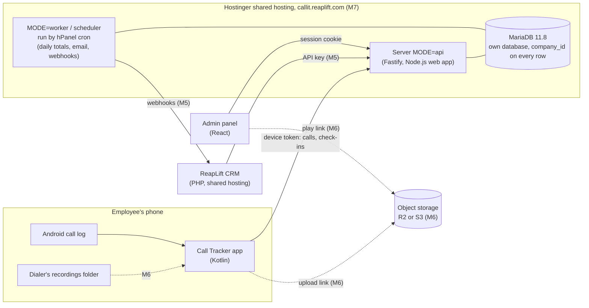

# ReapLift Call Tracker: Requirements and High-Level Design

Written 7 November 2026, from the owner's discussion of that day and a study of Callyzer (section 13). Where the tracker's decision log differs from this file, the tracker wins.

## 1. Background

The employees of ReapLift's client companies (for example BSNL and Country Roads, the companies its CRM serves) make sales and marketing calls on company-issued SIMs. Managers cannot see today who called whom, for how long, or what was said. Callyzer sells exactly this, with an Android app that syncs each phone's call log and recordings to a dashboard. ReapLift will build its own, for those companies, and show it inside its existing CRM. (Changed on 11 November 2026 from "for ReapLift's own employees" by decision D11.)

## 2. Goals

- Detailed **call history** for every employee: **every call on the company SIM** (D14: no matching against CRM leads, because clients' contacts often call from numbers that are not leads), with type, time, talk time, ringing time and, from M6, the recording. Calls on a personal SIM never leave the phone.
- Detailed **call reports**, covering everything Callyzer's call reports cover (section 6), for company-SIM calls only, never personal-SIM calls.
- **Easy install**: an employee goes from "never heard of it" to "tracking on" in a few minutes, with no Play Store and no help from IT.
- **Operational visibility**: detect silent or unhealthy phones, surface battery/autostart issues, and show which devices are still syncing normally.
- **Recordings are compulsory** (from M6): a missing recording is detected, shown to the manager and the employee is told, for company-SIM calls.
- **Daily summaries**: each morning managers and admins receive a concise view of yesterday's calls, no-answer rate and connected calls.
- The CRM shows all of this through our API, like a CRM would use Callyzer's.

- **Many companies** (D11): each company's data is kept apart, and each company's admins and managers see only their own company.

Not goals (owner, 7 November 2026): lead management, lead reports, iOS. Billing and per-company plans are not planned. (Selling to other companies was a not-goal until D11 on 11 November 2026; the tracker now serves the CRM's client companies.)

## 3. Users and roles

| Who | What they do | Where |
| --- | --- | --- |
| Super admin (ReapLift) | Adds and suspends companies and their first admin; picks a company to see what its admin sees | Admin panel (P1) |
| Admin | Adds employees, pairs phones, sees everything in **their company**, manages its settings | Admin panel (`apps/web`) |
| Manager | Sees call history, reports and recordings for their own teams in their company | Admin panel; later the CRM |
| Employee | Installs the app, pairs it, makes calls as normal; sees what was synced | Android app |
| CRM | Reads reports and history, receives webhooks | Integration API (M5) |

Managers arrive in M2, with teams. M1 has admins only. Super admins and companies arrive in P1.

## 4. Facts that shape the design

| Fact | Consequence |
| --- | --- |
| 50+ employees, mostly on **Oppo, Vivo and Samsung** phones | The app is tested on these three brands first |
| Employees use **personal phones with a company SIM** (usually dual-SIM) | Only company-SIM calls may leave the phone (privacy rule, CLAUDE.md) |
| iOS does not let apps read the call log | Android only |
| Installed as an **APK**, not from the Play Store (owner) | No Play review of the call-log permission; the app updates itself (M4); full file access is allowed for recordings (M6) |
| Android does not let ordinary apps record call audio | The phone's own dialer records; our app uploads its files (M6) |
| The Google dialer keeps its recordings where other apps cannot read them (reported by telecrm and Salestrail; to confirm on a real phone) | Phones on the Google dialer switch dialer (for example ODialer on Oppo-family phones) or get a company phone (owner) |
| The CRM is PHP and MySQL on Hostinger **shared hosting**, and the plan runs Node.js apps (D10) | Our service runs on the same shared plan as a Node.js web app with its own MariaDB database (M7); the CRM calls our API |
| The CRM serves several client companies, each with a `company_id` (D11) | Every company-data table carries the same `company_id` |
| **No working hours**: marketing calls can be made at any time (owner) | Reports never assume office hours (section 6) |

### Design rule: every company-SIM call is stored, nothing else

Decision D14 (owner, 11 November 2026) replaces the earlier rule that a call also had to match a CRM lead or approved contact list.

- **Every call on the employee's chosen company SIM is uploaded and stored**, whoever the other number is. Clients' friends and contacts often call directly from numbers that are not leads; matching against leads (an inner join) would lose those calls.
- **Calls on the personal SIM never leave the phone** (CLAUDE.md's privacy rule, unchanged). The phone filters them before anything is stored for upload.
- Employees are told in writing not to use the company SIM for personal calls, and customers are told calls are recorded (D13).
- Recordings follow the same rule: every company-SIM call's recording; no recording that does not match a company-SIM call is opened or uploaded.
- Linking a call to a CRM lead is done later as a **left join** for display (M5): calls with no matching lead are still kept and shown.

## 5. Scope

### First version (M0 to M8)

- Android app: setup wizard, company-SIM selection, call-log sync with ringing time, health check-ins, self-update, a note after a call, recording sync.
- Admin panel: login, employees, teams, phone pairing, call history with filters and CSV export, all reports, device health, recording player, settings.
- Daily email report.
- Integration API and webhooks for the CRM, and the CRM's Call Reports pages.
- Hosting on Hostinger shared hosting (D10), recordings in object storage, backups.
- Many companies, with a super admin (P1, D11).
- Operational visibility for silent or unhealthy phones, including auto-update and bad-battery symptoms, so managers know when a phone stopped reporting data.
- Recording coverage and playback views for company-SIM calls.

### Added by the client, 12 November 2026

- A Callyzer-compatible API for each company's own CRM (M5, built).
- A dashboard as the panel's first page: Today, Yesterday, Last 7 days, This month (M2 task 2.7, built).
- WhatsApp message templates (M10, design).
- The panel and app in the CRM's colours, fonts and icons (M11, design not started).
- A super admin list of numbers that are never recorded or stored (M12, design not started).

### Later, not planned

- Click-to-call from the CRM's web page. (Calling from the app is now planned as M9, owner, 11 November 2026: the app starts the call and the phone's own dialer places and records it.)
- **AI call summary** in the dashboard, like Zoom's meeting summary (owner, 11 November 2026: a later extension, not part of the current plan): transcribe each recording (Indian languages and mixed speech), then summarise it with key points and next action. Needs recordings (M6), legal approval for sending recordings to an AI provider, and a cost check, because transcription is charged per minute of talk.
- WhatsApp call tracking.
- A calling provider (Exotel, Knowlarity and similar) for phones that cannot record.
- Leads.

## 6. Report definitions

Fixed here once; the panel, the API, the daily email and the tests all use these. "Calls" always means company-SIM calls of employees, minus excluded numbers unless a report says otherwise.

| Term | Definition |
| --- | --- |
| Incoming, outgoing, missed, rejected | From the phone's call log type. Blocked calls count as rejected. Voicemail and no-answer events remain valid calls, and they are counted as attempts even when talk time is short or zero. |
| Talk time (`duration`) | Seconds connected, from the call log. For voicemail or no-answer events it may be a few seconds, but it is not treated as a live conversation. |
| Ringing time | Seconds from the call starting (ringing or dialling) to it being answered or ending, measured by the app (section 8.3) |
| Connected call | A live call where the other side answered and talk time is above 0; voicemail and no-answer events are not connected calls. |
| Attempt | Any valid company-SIM work call event, including outgoing calls that ended in voicemail, no answer, or a very short recording. |
| Unique clients | Distinct outside numbers in the period |
| Never attended | An outside number with a missed or rejected call in the period, and no connected call with it after that call within the period. A voicemail/no-answer event still counts as an attempt but not as a connected call. |
| Not picked up by client | An outside number with an outgoing call of 0 talk time in the period, and no connected call with it after that call within the period |
| Active time (shown as "working hours") | Per employee per India day: from the start of the first call to the end of the last call. There are no office hours (owner, 7 November 2026). |
| Idle time | Active time minus the time spent in calls (talk plus ringing) |
| Hourly analytics | Calls, connected calls and talk time in each hour of the day, 00:00 to 24:00 India time. A filter can narrow the hours shown; nothing is excluded by default. |
| Day-wise analytics | The same hourly slots per date, and how many days each slot had no calls |
| Top dialer, top caller, most answered | The employee with the most outgoing calls, the most incoming calls, the most connected incoming calls |
| Highest total talk time, longest call | By employee, and the single longest call |
| Averages | Talk time per call, per connected call, per incoming and outgoing call, per day with calls |

Excluded numbers (internal numbers, colleagues, office lines) are left out of every report by default, as Callyzer does, and can be included with a filter.

## 7. Architecture

- One server program; `MODE` picks what runs, as in `reaplift-bsp`.
- MariaDB holds everything except audio (PostgreSQL until P1). Background work uses a job table in the same database; no Redis or queue service. On shared hosting the API is started on request and stopped when idle, so the worker and scheduler run as short commands from hPanel cron (D10).
- Our database is separate from the CRM's. The CRM reads our data only through the integration API, where the company and role rules are applied (M5).
- The admin panel is ours, so every milestone can be demonstrated without the CRM. The CRM gets the same data through the integration API in M5 (decision D5).

## 8. Android app

### 8.1 Install and setup (M1)

1. The admin adds the employee in the panel (name, company SIM number) and clicks **Pair phone**. The panel shows a QR code and a 6-digit code, valid for 24 hours.
2. The employee scans the QR with the phone camera. It opens our download page, which offers the latest APK. Android asks once to allow installing from the browser.
3. The app opens a setup wizard, one step per screen:
   1. **Consent**: in plain language, what is collected (company-SIM calls; from M6 their recordings) and what is never collected. The employee taps Agree; the time and app version are stored.
   2. **Permissions**: call log, phone state, notifications. Each with one sentence on why.
   3. **Keep running**: battery optimisation off and autostart on, with a guide for the phone's brand (Samsung, Oppo, Vivo first).
   4. **Company SIM**: the app lists the SIMs (slot, carrier name) and the employee picks the company one; the panel's number is shown for comparison.
   5. **Pair**: the app reads the code from the QR (or the employee types it) and exchanges it for its device token.
   6. **Test call**: the employee makes a short call on the company SIM; the wizard shows "synced" when the server has it. Setup is complete.
4. A permanent notification says "Call Tracker is on".

### 8.2 Call-log sync (M1)

- **Trigger**: a content observer on the call log reacts to new calls within seconds; a WorkManager job every 15 minutes, and one at boot, catches anything missed.
- **Filter on the phone**: each call log row has a phone-account ID. The app keeps only rows whose ID matches the chosen company SIM. The ID's format differs by brand (subscription ID or SIM serial number), so the matching is tested per brand.
- **Outbox**: kept rows go into the app's own SQLite database, then are posted in batches of up to 200. The server's unique key is (device, call-log row ID), so a retried batch never duplicates.
- **Start point**: at pairing, the app syncs the company SIM's calls from the last 7 days (setting), then everything new.
- **SIM safety**: if the company SIM is no longer present (removed, swapped or moved), sync pauses, nothing is uploaded, and the app asks the employee to pick the SIM again. The server sees the pause through check-ins (M4).

### 8.3 Ringing time (M1)

The call log does not store ringing time. The app's foreground service listens to call-state changes for the company SIM only and records when each call ends. Ringing time = (end − start) − talk time. If the app was not running during the call, ringing time is left empty, not guessed. Some brands may count ringing in an outgoing call's talk time; checked per brand.

### 8.4 Staying alive (M1, M4)

- A foreground service with a permanent notification. Android 14+ requires a declared service type and Android 15 limits some types to a few hours a day; the type is chosen and checked on real phones in M1.
- The setup wizard's battery and autostart step, and a check-in to the server every 15 minutes (M4) so a silent phone shows on the dashboard.

### 8.5 Updates (M4)

The app checks our server for a newer version on start and daily, downloads it, and asks the employee to install it. Old versions keep working for a grace period set by the admin.

### 8.6 Recording sync (M6)

1. The employee turns on auto-record in the dialer (guided per brand). The wizard checks the default dialer and refuses the Google dialer, with the steps to switch.
2. After each connected company-SIM call, the app asks Android's media index (MediaStore, `READ_MEDIA_AUDIO`) for audio files saved between a minute before the call started and 10 minutes after it ended. It does not browse folders. All-files access stays a fallback for a brand whose dialer saves where the media index can't see (built 11 November 2026; confirmed per brand on real phones).
3. Each candidate is scored on save time against call end, audio length against talk time, and the number or contact name in the file name. The best match above a threshold is linked to the call.
4. The app asks the server for a 15-minute upload link and uploads the file straight to Cloudflare R2; the audio never passes through our server, and the database keeps only the file's key and details. The phone keeps its own copy. The panel plays a recording through a 5-minute link, and every play is audited. R2 moves files to Infrequent Access after 30 days and deletes them after 365 (D4).
5. No match within 10 minutes for a connected call of 5 seconds or more: the call is marked **recording missing**, the employee is told, and after 3 in a row the phone's status becomes **Recording off** on the dashboard.

Files that match no company-SIM call are never opened or uploaded.

### 8.7 Permissions

| Permission | Why | From |
| --- | --- | --- |
| `READ_CALL_LOG` | Read calls | M1 |
| `READ_PHONE_STATE` | List SIMs; ringing time | M1 |
| `POST_NOTIFICATIONS`, foreground service | The "on" notification; keep running | M1 |
| `RECEIVE_BOOT_COMPLETED` | Restart after a reboot | M1 |
| `REQUEST_IGNORE_BATTERY_OPTIMIZATIONS` | Ask to be left running | M1 |
| `REQUEST_INSTALL_PACKAGES` | Install its own updates | M4 |
| `READ_MEDIA_AUDIO` (Android 13+), `READ_EXTERNAL_STORAGE` (Android 12 and older) | Find the dialer's recording of a company-SIM call through the media index | M6 (built) |
| `SYSTEM_ALERT_WINDOW` ("Display over other apps") | Open the after-call pop-up over other apps when a call ends; without it the notification stays | M4 task 4.5 (built, app 0.5.0) |
| `MANAGE_EXTERNAL_STORAGE` | Fallback only, for a dialer the media index can't see | M6, if a brand needs it |

No contacts permission: the call log already carries the cached contact name.

### 8.8 After-call pop-up and call history screen (M4 task 4.5, built in app 0.5.0)

- **Pop-up:** when a company-SIM call ends, the app opens "Last call details" over whatever is on screen. It shows the number or contact, type, time, talk and ringing time, Call and WhatsApp buttons, the company's outcomes, a note with ready-made notes ("/" or a chip) and voice typing, and a follow-up date (Tomorrow, In 3 days, Next week, or a date). Buttons: Save & exit, Save & call again (opens the dialer), Later. It stays invisible, and lets taps through, until the app has confirmed the call was on the company SIM, so a personal-SIM call never shows it. Without "Display over other apps", a notification asks for the comment instead.
- **Saved offline:** a comment is saved on the phone at once and sent with the next sync. If the call hasn't reached the server yet (`CALL_NOT_SYNCED`), the phone keeps it and retries. Every call type can get a comment, missed and rejected included.
- **Call history screen:** the app opens on it. Tabs All, Incoming, Outgoing, Missed; search; calls grouped by day; each card with Call, WhatsApp, ▶ Play when a recording was uploaded, and "Tap here to add notes". It shows company-SIM calls only.
- **Panel:** each company's admin manages the outcomes and ready-made notes in Settings; phones pick up changes on their next sync.

### 8.9 WhatsApp message templates (M10, design approved in part; not built)

The super admin writes fixed templates with blanks. After a call, the employee picks one; the app fills what it knows (client name from the contact, employee and company name, follow-up date) and asks the employee for the rest; the employee reviews it and WhatsApp opens on the client's chat with the text ready. See the M10 spec.

## 9. Data

- Call rows are small (under 1 KB). 50 employees at about 150 calls a day is about 7,500 calls a day, 2.7 million a year: a few GB in MariaDB. This grows with each company added; 200 GB of disk on the shared plan covers years of call rows (recordings are in object storage).
- Recordings are about 0.5 MB a minute. 50 employees at about 4 hours of talk a day is about 6 GB a day, 1.5 TB a year.
- Retention (decision D4): call rows kept indefinitely; recordings 12 months, then deleted by a storage lifecycle rule.
- Backups (M7): nightly database dumps copied off Hostinger to object storage, kept 30 days, with a restore tested, as well as Hostinger's own backups.

## 10. Security and privacy

- Device tokens: random 32 bytes, stored as SHA-256 hashes, one per paired phone, revocable by the admin.
- Panel: httpOnly session cookie, as in `reaplift-bsp`.
- Integration API (M5): API keys stored hashed; webhooks signed with HMAC-SHA256.
- Recordings (M6): private bucket, encrypted at rest; the panel plays them through links that expire after 5 minutes; every play is written to the audit log.
- Consent stored per device. The employee's app shows exactly what was synced.
- Legal sign-off (D12): each company's signed agreement, each employee's signed policy, and each employee's in-app consent to their company's versioned consent text are all recorded, and the server refuses pairing and sync until they exist. Withdrawing consent unpairs the phone. A consent register per company is the proof.
- Companies (D11): every query is limited to one company by the server; a device writes only into its own company; tests prove one company cannot see another's data.
- India's DPDP Act 2023: consent, purpose (work calls on the company SIM), retention and the employee's view are designed in; ReapLift should have its policy checked (Q4 in open-questions.md).

## 11. Hosting

| Part | Where | Milestone |
| --- | --- | --- |
| Server, worker, MariaDB | Hostinger shared hosting (the existing plan): Node.js web app at `callit.reaplift.com`, hPanel cron, a MariaDB database, HTTPS. DNS in Cloudflare. If it grows, ReapLift upgrades within Hostinger; no other host and no PostgreSQL (D10, owner) | M7 |
| Recordings and backups | Cloudflare R2 on ReapLift's existing account (D6, decided 11 November 2026) | M6, M7 |
| APK downloads | Served by our server | M1 |
| CRM | Unchanged, on Hostinger shared hosting | M5 |

Until M7, a real phone reaches a developer's laptop over the same Wi-Fi, or through a tunnel.

## 12. Assumed or open

See the tracker's "Decisions that need the owner" and [open-questions.md](open-questions.md).

## 13. Reference: Callyzer

Studied on 7 November 2026 from callyzer.co, its pricing page, its help centre and its API reference v2.3 (developers.callyzer.co/v2.3/).

- **How it works**: the Callyzer Biz Android app syncs the call log and the phone dialer's recordings to a web dashboard. Callyzer does not record calls itself. Employees pick the SIM to track and the recordings folder. Its help centre has per-brand guides for autostart and battery settings (Xiaomi, Vivo, Oppo, Samsung, OnePlus, Tecno).
- **Pricing**: per phone number per month, from about ₹175; recording storage ₹500 per 5 GB per month; API and webhooks ₹150 per number per month.
- **Call API (all POST, JSON, bearer token, one request per 2 seconds)**: summary, employee summary, analysis, never attended, not picked up by client, unique clients, hourly analytics, day-wise analytics, history, history by IDs, remove recording, history stream (NDJSON), employee details, webhooks. Shared filters: call date or sync date range (at most 180 days), call types, talk-time and ringing-time bounds, employee numbers, employee tags, client numbers, exclude internal numbers; pages of up to 100.
- **Call record fields**: ID, employee (name, code, number, tags), client (name, number), duration, call type, date, time, note, recording URL, synced at, modified at, call method (phone or WhatsApp), call mode (voice or video), ringing time.
- **Employee details**: app version, registered at, last call at, last sync request at, recording active, device model and Android version, SIM ID, battery, uninstall status, recording location.
- **Things we do differently**: consistent field names and types; GET for single records; cursor pages; our own report definitions (section 6) written down and tested; no working-hours parameter, because ReapLift has none.
