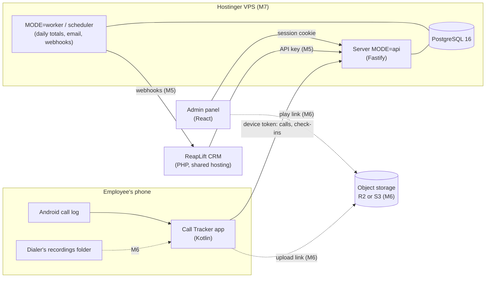

# ReapLift Call Tracker: Requirements and High-Level Design

Written 7 November 2026, from the owner's discussion of that day and a study of Callyzer (section 13). Where the tracker's decision log differs from this file, the tracker wins.

## 1. Background

ReapLift's employees make sales and marketing calls on company-issued SIMs. Managers cannot see today who called whom, for how long, or what was said. Callyzer sells exactly this, with an Android app that syncs each phone's call log and recordings to a dashboard. ReapLift will build its own, for its own employees, and show it inside its existing CRM.

## 2. Goals

- Detailed **call history** for every employee: only valid work calls on the company SIM, filtered to assigned CRM/customer numbers or approved business contacts, with type, time, talk time, ringing time and, from M6, the recording.
- Detailed **call reports**, covering everything Callyzer's call reports cover (section 6), but only for valid work calls, never personal calls.
- **Easy install**: an employee goes from "never heard of it" to "tracking on" in a few minutes, with no Play Store and no help from IT.
- **Recordings are compulsory** (from M6): a missing recording is detected, shown to the manager and the employee is told, but only for valid work calls.
- The CRM shows all of this through our API, like a CRM would use Callyzer's.

Not goals (owner, 7 November 2026): lead management, lead reports, selling the product to other companies, iOS.

## 3. Users and roles

| Who | What they do | Where |
| --- | --- | --- |
| Admin | Adds employees, pairs phones, sees everything, manages settings | Admin panel (`apps/web`) |
| Manager | Sees call history, reports and recordings for their own teams | Admin panel; later the CRM |
| Employee | Installs the app, pairs it, makes calls as normal; sees what was synced | Android app |
| CRM | Reads reports and history, receives webhooks | Integration API (M5) |

Managers arrive in M2, with teams. M1 has admins only.

## 4. Facts that shape the design

| Fact | Consequence |
| --- | --- |
| 50+ employees, mostly on **Oppo, Vivo and Samsung** phones | The app is tested on these three brands first |
| Employees use **personal phones with a company SIM** (usually dual-SIM) | Only company-SIM calls may leave the phone (privacy rule, CLAUDE.md) |
| iOS does not let apps read the call log | Android only |
| Installed as an **APK**, not from the Play Store (owner) | No Play review of the call-log permission; the app updates itself (M4); full file access is allowed for recordings (M6) |
| Android does not let ordinary apps record call audio | The phone's own dialer records; our app uploads its files (M6) |
| The Google dialer keeps its recordings where other apps cannot read them (reported by telecrm and Salestrail; to confirm on a real phone) | Phones on the Google dialer switch dialer (for example ODialer on Oppo-family phones) or get a company phone (owner) |
| The CRM is PHP and MySQL on Hostinger **shared hosting** | Our service runs on its own Hostinger VPS (M7); the CRM calls our API |
| **No working hours**: marketing calls can be made at any time (owner) | Reports never assume office hours (section 6) |

### Design rule: not every call from the phone is stored

The tracker is not a full "all phone calls" logger. It only stores calls that are both:

1. on the employee's chosen company SIM, and
2. linked to a valid work context such as an assigned CRM/customer number or another approved business contact list

Private calls, personal-SIM calls, unassigned numbers, and irrelevant call patterns are filtered before upload and never stored. The same rule applies to recordings: recordings are created and uploaded only for valid work calls that passed this check.

## 5. Scope

### First version (M0 to M8)

- Android app: setup wizard, company-SIM selection, call-log sync with ringing time, health check-ins, self-update, a note after a call, recording sync.
- Admin panel: login, employees, teams, phone pairing, call history with filters and CSV export, all reports, device health, recording player, settings.
- Daily email report.
- Integration API and webhooks for the CRM, and the CRM's Call Reports pages.
- Hosting on a Hostinger VPS, recordings in object storage, backups.

### Later, not planned

- Click-to-call from the app or CRM (places the call on the company SIM and links it to a CRM contact).
- WhatsApp call tracking.
- A calling provider (Exotel, Knowlarity and similar) for phones that cannot record.
- Leads.

## 6. Report definitions

Fixed here once; the panel, the API, the daily email and the tests all use these. "Calls" always means company-SIM calls of employees, minus excluded numbers unless a report says otherwise.

| Term | Definition |
| --- | --- |
| Incoming, outgoing, missed, rejected | From the phone's call log type. Blocked calls count as rejected. Voicemail and no-answer events remain valid calls, and they are counted as attempts even when talk time is short or zero. |
| Talk time (`duration`) | Seconds connected, from the call log. For voicemail or no-answer events it may be a few seconds, but it is not treated as a live conversation. |
| Ringing time | Seconds from the call starting (ringing or dialling) to it being answered or ending, measured by the app (section 8.3) |
| Connected call | A live call where the other side answered and talk time is above 0; voicemail and no-answer events are not connected calls. |
| Attempt | Any valid company-SIM work call event, including outgoing calls that ended in voicemail, no answer, or a very short recording. |
| Unique clients | Distinct outside numbers in the period |
| Never attended | An outside number with a missed or rejected call in the period, and no connected call with it after that call within the period. A voicemail/no-answer event still counts as an attempt but not as a connected call. |
| Not picked up by client | An outside number with an outgoing call of 0 talk time in the period, and no connected call with it after that call within the period |
| Active time (shown as "working hours") | Per employee per India day: from the start of the first call to the end of the last call. There are no office hours (owner, 7 November 2026). |
| Idle time | Active time minus the time spent in calls (talk plus ringing) |
| Hourly analytics | Calls, connected calls and talk time in each hour of the day, 00:00 to 24:00 India time. A filter can narrow the hours shown; nothing is excluded by default. |
| Day-wise analytics | The same hourly slots per date, and how many days each slot had no calls |
| Top dialer, top caller, most answered | The employee with the most outgoing calls, the most incoming calls, the most connected incoming calls |
| Highest total talk time, longest call | By employee, and the single longest call |
| Averages | Talk time per call, per connected call, per incoming and outgoing call, per day with calls |

Excluded numbers (internal numbers, colleagues, office lines) are left out of every report by default, as Callyzer does, and can be included with a filter.

## 7. Architecture

- One server program; `MODE` picks what runs, as in `reaplift-bsp`.
- PostgreSQL holds everything except audio. Background work uses a PostgreSQL job table; no Redis or queue service.
- The admin panel is ours, so every milestone can be demonstrated without the CRM. The CRM gets the same data through the integration API in M5 (decision D5).

## 8. Android app

### 8.1 Install and setup (M1)

1. The admin adds the employee in the panel (name, company SIM number) and clicks **Pair phone**. The panel shows a QR code and a 6-digit code, valid for 24 hours.
2. The employee scans the QR with the phone camera. It opens our download page, which offers the latest APK. Android asks once to allow installing from the browser.
3. The app opens a setup wizard, one step per screen:
   1. **Consent**: in plain language, what is collected (company-SIM calls; from M6 their recordings) and what is never collected. The employee taps Agree; the time and app version are stored.
   2. **Permissions**: call log, phone state, notifications. Each with one sentence on why.
   3. **Keep running**: battery optimisation off and autostart on, with a guide for the phone's brand (Samsung, Oppo, Vivo first).
   4. **Company SIM**: the app lists the SIMs (slot, carrier name) and the employee picks the company one; the panel's number is shown for comparison.
   5. **Pair**: the app reads the code from the QR (or the employee types it) and exchanges it for its device token.
   6. **Test call**: the employee makes a short call on the company SIM; the wizard shows "synced" when the server has it. Setup is complete.
4. A permanent notification says "Call Tracker is on".

### 8.2 Call-log sync (M1)

- **Trigger**: a content observer on the call log reacts to new calls within seconds; a WorkManager job every 15 minutes, and one at boot, catches anything missed.
- **Filter on the phone**: each call log row has a phone-account ID. The app keeps only rows whose ID matches the chosen company SIM. The ID's format differs by brand (subscription ID or SIM serial number), so the matching is tested per brand.
- **Outbox**: kept rows go into the app's own SQLite database, then are posted in batches of up to 200. The server's unique key is (device, call-log row ID), so a retried batch never duplicates.
- **Start point**: at pairing, the app syncs the company SIM's calls from the last 7 days (setting), then everything new.
- **SIM safety**: if the company SIM is no longer present (removed, swapped or moved), sync pauses, nothing is uploaded, and the app asks the employee to pick the SIM again. The server sees the pause through check-ins (M4).

### 8.3 Ringing time (M1)

The call log does not store ringing time. The app's foreground service listens to call-state changes for the company SIM only and records when each call ends. Ringing time = (end − start) − talk time. If the app was not running during the call, ringing time is left empty, not guessed. Some brands may count ringing in an outgoing call's talk time; checked per brand.

### 8.4 Staying alive (M1, M4)

- A foreground service with a permanent notification. Android 14+ requires a declared service type and Android 15 limits some types to a few hours a day; the type is chosen and checked on real phones in M1.
- The setup wizard's battery and autostart step, and a check-in to the server every 15 minutes (M4) so a silent phone shows on the dashboard.

### 8.5 Updates (M4)

The app checks our server for a newer version on start and daily, downloads it, and asks the employee to install it. Old versions keep working for a grace period set by the admin.

### 8.6 Recording sync (M6)

1. The employee turns on auto-record in the dialer (guided per brand). The wizard checks the default dialer and refuses the Google dialer, with the steps to switch.
2. After each connected company-SIM call, the app looks in the dialer's recordings folder for a file saved within a few minutes of the call ending.
3. Each candidate is scored on save time against call end, audio length against talk time, and the number or contact name in the file name. The best match above a threshold is linked to the call.
4. The app asks the server for a one-time upload link and uploads the file straight to object storage, resuming after interruptions. The phone keeps its own copy.
5. No match within 10 minutes for a connected call of 5 seconds or more: the call is marked **recording missing**, the employee is told, and after 3 in a row the phone's status becomes **Recording off** on the dashboard.

Files that match no company-SIM call are never opened or uploaded.

### 8.7 Permissions

| Permission | Why | From |
| --- | --- | --- |
| `READ_CALL_LOG` | Read calls | M1 |
| `READ_PHONE_STATE` | List SIMs; ringing time | M1 |
| `POST_NOTIFICATIONS`, foreground service | The "on" notification; keep running | M1 |
| `RECEIVE_BOOT_COMPLETED` | Restart after a reboot | M1 |
| `REQUEST_IGNORE_BATTERY_OPTIMIZATIONS` | Ask to be left running | M1 |
| `REQUEST_INSTALL_PACKAGES` | Install its own updates | M4 |
| `MANAGE_EXTERNAL_STORAGE` (Android 11+), `READ_EXTERNAL_STORAGE` (older) | Read the dialer's recordings folder | M6 |

No contacts permission: the call log already carries the cached contact name.

## 9. Data

- Call rows are small (under 1 KB). 50 employees at about 150 calls a day is about 7,500 calls a day, 2.7 million a year: a few GB in PostgreSQL.
- Recordings are about 0.5 MB a minute. 50 employees at about 4 hours of talk a day is about 6 GB a day, 1.5 TB a year.
- Retention (decision D4): call rows kept indefinitely; recordings 12 months, then deleted by a storage lifecycle rule.
- Backups (M7): nightly PostgreSQL dumps copied off the VPS to object storage, kept 30 days, with a restore tested.

## 10. Security and privacy

- Device tokens: random 32 bytes, stored as SHA-256 hashes, one per paired phone, revocable by the admin.
- Panel: httpOnly session cookie, as in `reaplift-bsp`.
- Integration API (M5): API keys stored hashed; webhooks signed with HMAC-SHA256.
- Recordings (M6): private bucket, encrypted at rest; the panel plays them through links that expire after 5 minutes; every play is written to the audit log.
- Consent stored per device. The employee's app shows exactly what was synced.
- India's DPDP Act 2023: consent, purpose (work calls on the company SIM), retention and the employee's view are designed in; ReapLift should have its policy checked (Q4 in open-questions.md).

## 11. Hosting

| Part | Where | Milestone |
| --- | --- | --- |
| Server, worker, PostgreSQL | One Hostinger VPS, Docker Compose, HTTPS | M7 |
| Recordings and backups | Cloudflare R2 or AWS S3 Mumbai (decision D6) | M6, M7 |
| APK downloads | Served by our server | M1 |
| CRM | Unchanged, on Hostinger shared hosting | M5 |

Until M7, a real phone reaches a developer's laptop over the same Wi-Fi, or through a tunnel.

## 12. Assumed or open

See the tracker's "Decisions that need the owner" and [open-questions.md](open-questions.md).

## 13. Reference: Callyzer

Studied on 7 November 2026 from callyzer.co, its pricing page, its help centre and its API reference v2.3 (developers.callyzer.co/v2.3/).

- **How it works**: the Callyzer Biz Android app syncs the call log and the phone dialer's recordings to a web dashboard. Callyzer does not record calls itself. Employees pick the SIM to track and the recordings folder. Its help centre has per-brand guides for autostart and battery settings (Xiaomi, Vivo, Oppo, Samsung, OnePlus, Tecno).
- **Pricing**: per phone number per month, from about ₹175; recording storage ₹500 per 5 GB per month; API and webhooks ₹150 per number per month.
- **Call API (all POST, JSON, bearer token, one request per 2 seconds)**: summary, employee summary, analysis, never attended, not picked up by client, unique clients, hourly analytics, day-wise analytics, history, history by IDs, remove recording, history stream (NDJSON), employee details, webhooks. Shared filters: call date or sync date range (at most 180 days), call types, talk-time and ringing-time bounds, employee numbers, employee tags, client numbers, exclude internal numbers; pages of up to 100.
- **Call record fields**: ID, employee (name, code, number, tags), client (name, number), duration, call type, date, time, note, recording URL, synced at, modified at, call method (phone or WhatsApp), call mode (voice or video), ringing time.
- **Employee details**: app version, registered at, last call at, last sync request at, recording active, device model and Android version, SIM ID, battery, uninstall status, recording location.
- **Things we do differently**: consistent field names and types; GET for single records; cursor pages; our own report definitions (section 6) written down and tested; no working-hours parameter, because ReapLift has none.
